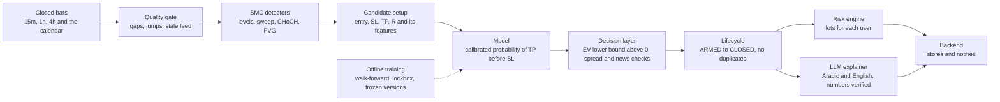
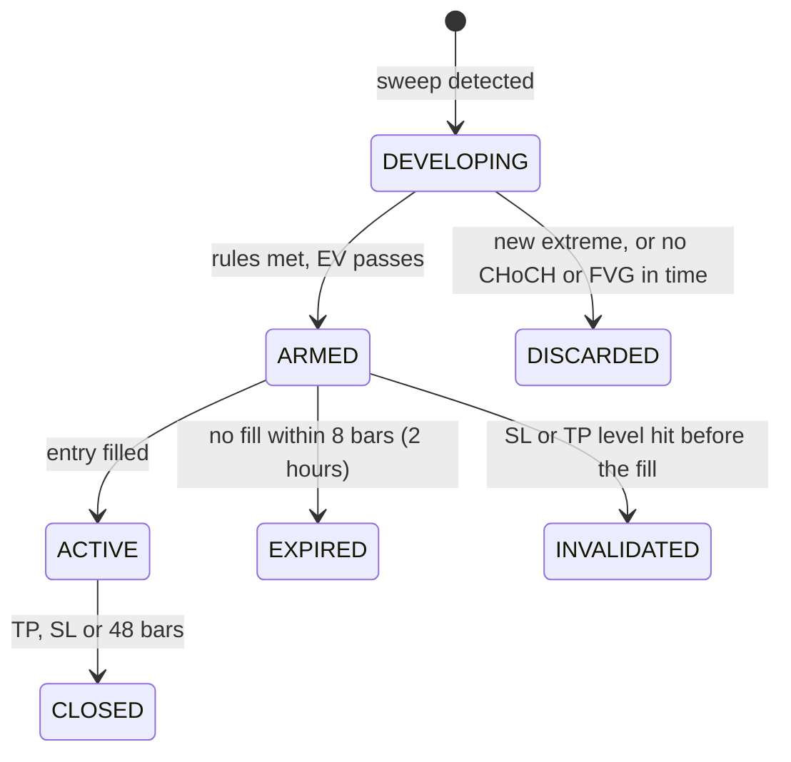

# AI Engine Requirements and Technical Design

_As of 2026-10-19 · Fadi. Version-controlled copy of the shared doc
(https://claude.ai/code/artifact/cdedf736-ece2-4b02-a9b2-4cb9ed88044f). The decision log with rationale is in
[PROJECT_CONTEXT.md](PROJECT_CONTEXT.md). The backend changes are in the doc "Backend Changes for the AI Engine"
(https://claude.ai/code/artifact/dc7486a5-4da8-4f08-95ca-4780e5b09357)._

## Summary

The AI engine finds intraday XAU/USD trade setups with explicit Smart Money Concepts rules, scores each one with a
trained model, and signals only when expected value after costs is positive with confidence. Otherwise it answers
NO TRADE and says why. It never places trades. It gives entry, SL, TP and a lot size sized to each user's own risk
settings, and an LLM explains the result in Arabic and English without producing any number itself.

**v1 (the graduation core):**

- One formally defined SMC strategy (Sweep → CHoCH → FVG) on the Intraday profile: context 1h/4h, entry 15m.
- A model that estimates P(TP before SL), compared across logistic regression, gradient boosting and a small MLP.
- A signal lifecycle with no duplicate alerts, a risk engine, a news filter, and grounded LLM explanations.
- Rigorous validation: walk-forward, a one-time lockbox, cost stress tests, and at least 3 months of paper trading.

**Later phases (designed now, built after v1):** the Scalping profile, user-defined strategies in natural
language, multiple TPs with partial closes, sentiment features, raw-candle neural networks and more FX pairs.

## Constraints and confirmed decisions

All decisions below were confirmed by Fadi in the requirements Q&A on 2026-10-19.

| # | Area | Decision | Rejected alternatives |
| --- | --- | --- | --- |
| D1 | AI requirement | The analytical core contains a trained ML or neural-network model; an LLM alone does not count | LLM-only "AI" |
| D2 | Engine type | Hybrid: rules propose setups, a model scores them (meta-labelling), built in stages | Rules only; pure prediction |
| D3 | Profiles | Scalping and Intraday, chosen by the user; **Intraday built first**; Swing out of scope | Both at once; Scalping first |
| D4 | Data | $0 data budget; FxPro MT5 (real account, read-only access); FxPro M5 history 2012–2026 on hand; Yazan builds the adapters | Paid feeds |
| D5 | Strategy | One precisely defined SMC strategy plus simple baselines; no SMC expert on the team | Several SMC strategies; classical only |
| D6 | Pattern | Liquidity-sweep reversal: Sweep → CHoCH → FVG; session is a feature, not a filter | Trend continuation via Order Block; Asian-range sweep |
| D7 | Targets | TP at the nearest opposite liquidity, R between 1.5 and 4; multiple TPs deferred | Fixed 2R (kept as an ablation) |
| D8 | Entry and lifecycle | Limit at the FVG's proximal edge; 8-bar entry window; 48-bar horizon; lifecycle with DEVELOPING, ARMED, ACTIVE, CLOSED, EXPIRED, INVALIDATED | Market entry |
| D9 | Confidence | Calibrated probability, EV in R after costs, A/B/C grade; signal only if the EV lower bound is above 0 | An undefined "confidence %" |
| D10 | Success | Detection precision ≥ 90%; 95% statistical confidence; a 40–50% win rate is fine; positive EV after costs is the goal to test | 70% win rate or accuracy |
| D11 | Deadline | No fixed date (about a year); work by milestones with Claude Code | Weekly plan |
| D12 | Risk | Each user sets their own risk; the engine sizes lots; advisory only, never executes | Fixed presets; auto-trading |
| D13 | LLM | Provider-agnostic; free tier first, small paid budget possible; Arabic and English; numbers always verified | Self-hosted model |
| D14 | Boundary | ai-service is stateless and owns all analytical logic; the backend stores, schedules and delivers | Independent ai-service with its own DB; logic in the backend |
| D15 | Features and models | Setup geometry, context, cost, news timing; LR vs gradient boosting vs MLP; raw-candle NNs later | Deep sequence models in v1 |
| D16 | Validation | Dev 2012–2017, walk-forward 2018–2024-06, lockbox 2024-07–2026-01 opened once, paper trading ≥ 3 months or 100 signals | Random splits |
| D17 | Failures | Quality gate, degraded mode, ordered catch-up with no late alerts; no ARMED signals when the model is down | Rules-only fallback |
| D18 | Later features | User-defined strategies via LLM → Builder JSON → confirm → backtest; "what if" scenarios as conditional plans with "watch it for me" | LLM interpreting strategies directly |
| D19 | Deliverables | AI chapter, evaluation report, model card, paper-trading log, detector review, explanation audit, live demo, reproducibility; report in Arabic and English | — |

## Architecture

ai-service is stateless and owns every analytical step. The backend feeds it closed bars on each bar close and
stores what it returns. The same code runs in backtests and live, so historical and live behaviour match.



The model is trained offline and deployed as a frozen, versioned file; nothing in the live path learns or
retrains. ai-service exposes three endpoints, `/v1/evaluate`, `/v1/size` and `/v1/explain`, specified in
"Backend Changes for the AI Engine".

## Functional requirements

"Must" items are v1; "Later" items are designed now and built after v1.

| ID | Requirement | Priority |
| --- | --- | --- |
| FR-01 | Evaluate XAU/USD on every closed 15m bar, using only closed 15m, 1h and 4h bars | Must |
| FR-02 | Detect swings, liquidity levels, sweeps, CHoCH and FVGs exactly as defined in the Strategy section, with no look-ahead | Must |
| FR-03 | Build candidate setups with direction, entry, SL, TP and R; reject any with R below 1.5; cap TP at 4R | Must |
| FR-04 | Score each candidate with a calibrated probability and compute EV in R after costs, with a confidence interval | Must |
| FR-05 | Mark a setup ARMED only when every abstention check passes; otherwise return NO TRADE with the reason | Must |
| FR-06 | Advance each open setup through the lifecycle on every bar and record every transition with its reason | Must |
| FR-07 | Never issue a duplicate: one setup per direction and swept level while ARMED or ACTIVE | Must |
| FR-08 | Compute per-user lot size, risk in USD and margin from the user's balance, leverage and risk settings; refuse infeasible sizes with a warning | Must |
| FR-09 | Pause new signals for a user who reaches their daily loss or drawdown limit | Must |
| FR-10 | Explain each ARMED setup in Arabic and English through the LLM, from the structured setup only; fall back to a template if any number fails verification | Must |
| FR-11 | Answer questions about current signals and market state from engine output only | Must |
| FR-12 | Show the strategy's historical statistics (win rate, mean R, count, CI) alongside each signal | Must |
| FR-13 | Answer "what if price reaches X" with a conditional plan labelled as a hypothesis, with no probability or EV | Must |
| FR-14 | Let a user subscribe to a scenario and alert them only if a real setup reaches ARMED there | Must |
| FR-15 | Show DEVELOPING setups as "watch, not a signal" | Must |
| FR-16 | Report "no valid setup" explicitly when nothing qualifies | Must |
| FR-17 | Store every input needed to reproduce any signal exactly (versions, features, data window ID) | Must |
| FR-18 | Scalping profile (entry on 1m–5m) on the same pipeline | Later |
| FR-19 | User-defined strategies from natural language via the Builder JSON, with clarifying questions, confirmation and a mandatory backtest | Later |
| FR-20 | Multiple TPs with partial closes | Later |
| FR-21 | Sentiment and cross-asset features, kept only if ablations show value | Later |

## Non-functional requirements

| ID | Requirement | Target |
| --- | --- | --- |
| NFR-01 | Latency from bar close to a stored ARMED setup | Under 10 s at the 95th percentile |
| NFR-02 | ai-service memory in production | Within 256 MB and 0.5 CPU on the shared VPS |
| NFR-03 | Determinism | Same inputs and versions give byte-identical outputs, in backtest and live |
| NFR-04 | No look-ahead | An automated test proves that appending future bars never changes past outputs |
| NFR-05 | Reproducibility | Any experiment re-runs with one command from config plus data hash |
| NFR-06 | Traceability | Every signal links to its data window, strategy, model and feature versions |
| NFR-07 | Safety | The system never places, modifies or closes orders; broker access is read-only |
| NFR-08 | LLM grounding | Zero numbers in explanations that are absent from the engine output |
| NFR-09 | Availability on bad data | The engine abstains on bad or stale data and never errors silently |
| NFR-10 | Privacy | User strategies, settings and their signals are visible only to their owner |
| NFR-11 | Training cost | Every v1 model trains on a laptop CPU in minutes; no GPU needed |
| NFR-12 | Portability | Data, LLM and broker sources sit behind interfaces and can be swapped |

## Market data

The engine needs closed XAU/USD bars in UTC with a spread value, from one consistent source for history and live use.

| Use | Source | Notes |
| --- | --- | --- |
| Research history | FxPro MT5 M5 export, 2012-04-23 to 2026-01-09 (322,801 bars at 15m) | Includes spread in points (1 point = $0.01); stored as files in ai-service |
| Live and recent history | FxPro MT5 or cTrader, via backend adapters | Investor (read-only) password only |
| Cross-check and 1m history for Scalping | Dukascopy, free, bid and ask | Later; also measures the difference between feeds |
| Economic calendar | Free source, live and historical, point in time | Source still open |
| Cross-asset (ablation) | EURUSD from FxPro; daily US yields from FRED | Optional |

**Rules the pipeline must follow:**

- **Timezone:** FxPro server time is New York time + 7 h (UTC+2 winter, UTC+3 under US daylight saving), verified
  on the export. Convert to UTC before any use.
- **Price basis:** OHLC on bid, plus the spread. The MT5 bar spread is the in-bar minimum, so costs add a margin
  (see Validation).
- **Closed bars only:** higher timeframes are built from closed lower bars, and a 1h or 4h value is used only after
  its bar closes.
- **Expected gaps:** the weekend and the daily break (17:00–18:00 New York) are not data errors.
- **Point in time:** calendar events carry `fetched_at`; features use only what was known at decision time.
- **Quality gate:** missing bars, OHLC inconsistencies, extreme jumps or a stale feed stop evaluation with a
  recorded reason.
- **Known data issue:** the EURUSD export's first data row is malformed and must be dropped by the importer.

## Strategy definition: Sweep → CHoCH → FVG

This is a formal, testable interpretation of public ICT/SMC concepts, not "the" ICT strategy. The rules below
describe a **sell**; a buy mirrors every rule. Every number is an initial value, tuned only on the 2012–2017
development period and then frozen.

1. **Swing points.** A swing high on timeframe T is a bar whose high is above the highs of the k bars on each side.
   It is confirmed only at the close of the k-th bar after it, so it is never used earlier (confirmation lag = k
   bars). Initial k: 3 on 1h and 4h, 2 on 15m.
2. **Liquidity levels.** Confirmed 1h and 4h swing highs not yet traded through, plus the previous trading day's
   high. A trading day runs 17:00–17:00 New York time. Levels older than 5 trading days are dropped.
3. **Sweep.** A closed 15m bar trades above a level L by at least 0.1 × ATR(14, 15m), and that bar or the next one
   closes back below L. Penetration above 1.5 × ATR counts as a breakout, not a sweep. The sweep extreme is the
   highest high of those bars. The setup becomes **DEVELOPING**.
4. **CHoCH.** Within 8 bars of the sweep, a 15m bar closes below the most recent confirmed 15m swing low that formed
   before the sweep extreme. A new high above the sweep extreme first discards the setup (**DISCARDED**).
5. **FVG.** In the move from the sweep extreme to the CHoCH bar, take the first bearish three-bar gap: the low of
   bar i−2 is above the high of bar i. Its size must be at least 0.1 × ATR. No qualifying FVG discards the setup.
   **Amended 2026-10-19 (v2, after the manual review):** bar i must be the CHoCH bar or one of the 6 entry bars
   before it, counted in bars, so the gap belongs to the displacement that broke structure. A small gap stays
   valid if it meets the minimum size. The rules for the sweep, CHoCH, entry, SL and TP are unchanged.
   - **Frozen v2 rule set (`FROZEN_V2`):** 5m entry bars; the sweep may extend within 1.5 ATR; Asian and London
     session levels added; windows of 24, 24 and 144 bars. See the attempts log in PROJECT_CONTEXT.md.
   - **Frozen v3 rule set (`FROZEN_V3`, 2026-10-19, after the pattern-validity review):** v2 with one combined
     change. The FVG must be at least 0.25 × ATR (rule 5), the sweep's first bar must trade through the level by
     at least 0.25 × ATR (rule 3), and the CHoCH reference is a swing with k = 3 on the entry bars (rules 1 and 4).
     Everything else is v2.
6. **Entry.** A sell limit at the FVG's proximal edge (the high of bar i). The midpoint is an ablation.
7. **Stop-loss.** Sweep extreme + 0.1 × ATR + current spread.
8. **Take-profit.** The nearest opposite liquidity level (confirmed 1h/4h swing low or previous day's low) that gives
   R of at least 1.5. If that level is beyond 4R, TP is set at 4R. No qualifying level rejects the setup.
9. **Context (features, not filters).** 1h/4h trend, volatility regime, session (Asia, London, New York), distance
   to daily levels, and time to the next high-impact event.

**Baselines** that use the same entry, SL, TP and horizon mechanics:

- **Base rate:** random entries, as already measured (see Validation).
- **Rules only:** every rule-qualified setup, with no model filter.
- **Existing strategies** from `libs/strategies`, wrapped with the same risk mechanics.

**Verification:** unit tests per primitive on hand-built bar sequences, an append-future-bars no-look-ahead test,
and a manual chart review of about 50 detected setups (target precision ≥ 90%).

## Signal lifecycle and output contract

A setup moves through fixed states on closed bars only. Each setup has a deterministic ID built from its direction
and the swept level, so the same opportunity is never alerted twice. Only ARMED is a new signal; the other states
update it or say why it ended.



DEVELOPING shows in the app as a watch, never a signal. Each transition is stored with its reason and time.
Unfilled setups (EXPIRED, INVALIDATED) are kept for analysis but never count as wins or losses.

**Trade-setup contract (one ARMED setup):**

| Field | Example | Meaning |
| --- | --- | --- |
| `setup_id` | `xau-sell-L2748.20-2026-10-19` | Deterministic: direction + swept level |
| `state` | ARMED | Lifecycle state |
| `direction` | sell | Buy or sell |
| `entry` / `sl` / `tp` | 2741.50 / 2752.10 / 2719.30 | Limit entry at the FVG edge, SL beyond the sweep, TP at opposite liquidity |
| `r_multiple` | 2.1 | Reward over risk, between 1.5 and 4 |
| `probability` | 0.47 | Calibrated P(TP before SL) |
| `ev_r`, `ev_r_lower` | 0.31, 0.05 | EV after costs and its lower confidence bound |
| `grade` | B | Display band from EV |
| `valid_until` / `horizon_until` | UTC times | End of the entry window / of the holding horizon |
| `evidence` | sweep, CHoCH, FVG bars and prices | Observable facts the rules used |
| `features` | named values | The model's inputs, for traceability |
| `versions` | strategy, model, features | For exact reproduction |
| `invalidation` | text + levels | What cancels the idea |
| `risk_notes` | spread now, next event | Execution considerations |

Price values in the example are illustrative only. Sizing (`lots`, `risk_usd`, `margin_required`, `warnings`) is
added per user by `/v1/size`.

## Confidence, decision rule and abstention

Confidence is a calibrated probability, and the signal decision is made on expected value after costs, never on
the probability alone. A 40% setup at 3R is worth more than a 60% setup at 1.5R.

```
EV_R = p × R − (1 − p) × 1 − c_R
```

Here p is the calibrated probability of TP before SL, R is the setup's reward-to-risk, and c_R is the round-trip
cost in units of R.

**Shown to users:**

- **Probability:** "47% chance TP is hit before SL", calibrated out of sample.
- **EV:** for example "+0.31R after costs".
- **Grade:** A, B or C from fixed EV bands, for quick reading only (band edges are set on walk-forward data and
  then frozen).

**A setup becomes ARMED only if all of these hold:**

1. Every strategy rule is met.
2. The lower bound of the EV confidence interval is above 0.
3. The current spread is within its normal range for that hour.
4. No high-impact event is within ±30 minutes.
5. The model is available and its version matches the feature version.

Otherwise the result is **NO TRADE** with a reason code: `rules_not_met`, `ev_insufficient`, `spread_high`,
`news_window`, `model_unavailable` or `data_quality`.

**Before the model exists** (the rules-only stage), signals show the strategy's historical statistics instead,
labelled "strategy history, not an estimate for this setup".

## Machine learning

The model answers one question per rule-qualified setup: will TP be hit before SL within the horizon? It never
chooses direction, entry, SL, TP or size.

**Labels**

- Built from every setup the rules produce on history, using the backtest semantics of `trading_backtest`.
- 1 = TP before SL within 48 bars after the fill. 0 = SL first, or a timeout. An ambiguous bar counts as SL. The
  realised R is kept for trading metrics.
- Unfilled setups (EXPIRED, INVALIDATED) are logged but excluded from training labels.

**Features (v1)**

| Family | Examples |
| --- | --- |
| Setup geometry | R, SL distance in ATR, FVG size in ATR, sweep depth, CHoCH displacement, bars from sweep to CHoCH |
| Market context | 1h/4h trend, ATR percentile, distance to the previous day's high and low, session, day of week |
| Cost | Current spread relative to its median for that hour |
| News timing | Minutes to the next and since the last high-impact event |

All features are scale-free (ATR units or percentiles), because gold rose from about $1,600 to $4,500 over the
data. Cross-asset features (EURUSD, US yields) are an ablation. Sentiment comes later and only if it helps.

**Models, compared on the same features and splits**

1. Base rate, and rules with no filter.
2. Logistic regression.
3. Gradient boosting (LightGBM or XGBoost).
4. A small MLP, the neural-network arm of the comparison.

Probabilities are calibrated on a chronologically later slice (isotonic or Platt, whichever is better on Brier
score). Raw-candle sequence networks (LSTM, Transformer) are deferred: a few thousand samples is too few for them.

**Sample size check:** Phase 3 starts by counting rule-qualified setups per year. If there are fewer than about
1,000 in total, the rules are revisited on development data before any model work.

## Risk engine and position sizing

Sizing is deterministic code, never a model output. It extends `plan_trade` and `Sizer` in `libs/backtest` and
fixes the known currency bug: today USD/JPY plans come out about 150× too small.

```
lots = floor_to_lot_step( balance × risk% / ((|entry − SL| + spread) × contract_size) )
```

- **User inputs:** balance, account currency (USD only in v1), leverage, risk per trade, daily loss limit and
  maximum drawdown. There are no fixed presets.
- **Broker inputs:** contract size (100 oz for XAU/USD), lot step, minimum and maximum lot, margin rate; all read
  from the FxPro specification.
- **Feasibility:** if the minimum lot risks more than the user's chosen amount, or margin is insufficient, no size
  is shown, only a warning that explains why.
- **High risk:** no hard cap; above 5% per trade, show the drawdown after a typical losing streak (for example,
  five 10% losses in a row remove about 41% of the account).
- **Limits:** reaching the daily loss or drawdown limit pauses new signals for that user. This is tracked from
  signals the user marked as taken.
- **Advisory only:** nothing is ever sent to a broker.

## LLM integration

The LLM turns structured engine output into language and turns language into structured requests. It never
analyses the market, never produces a number, and never decides a signal.

| Use | Input to the LLM | Output | Guardrail | Phase |
| --- | --- | --- | --- | --- |
| Signal explanation | The setup's JSON (levels, evidence, probability, EV, reasons) | Arabic and English text | Every number in the text is checked against the JSON; any mismatch falls back to a fixed template | v1 |
| Grounded Q&A | The question plus current engine output | An answer citing that output | Answers only from supplied data; otherwise says it does not know | v1 |
| "What if" scenarios | The question | `{price, direction, profile}` | Schema-validated; asks when ambiguous. The engine builds the conditional plan | v1 |
| User-defined strategies | The strategy text | Builder JSON | Schema-validated; unknown concepts refused; ambiguity becomes questions; user confirms; backtest before activation | Later |

**Scenario answers** label every statement as an observed fact, a rule-based interpretation, a statistical
estimate or an unconfirmed hypothesis. They contain no probability or EV, because the features do not exist yet.
With "watch it for me", the user is alerted only if a real setup reaches ARMED at that level.

**Provider:** behind one interface; a free tier for development and a small paid budget possible for the final
demo. If the LLM is down, signals still work and explanations use the template.

## Validation and acceptance

Every performance claim must come from data the model never saw, after realistic costs. Chance is the bar to beat,
and on gold it is measurable. At TP 1.5R, random entries win about 32% after spread, so an "always loses" model
already scores about 67% accuracy. Accuracy is therefore not an acceptance metric.

**Random-entry base rates** (FxPro MT5 M5 export aggregated to 15m, 2012–2026; SL 1 × ATR(14), 48-bar horizon,
stop-first; 92,210 random entries per TP level; run 2026-10-19):

| TP | Win before spread | Win after spread | Break-even before costs, 1 / (1 + R) |
| --- | --- | --- | --- |
| 1R | 49.2% | 40.5% | 50% |
| 1.5R | 39.2% | 32.2% | 40% |
| 2R | 32.2% | 26.4% | 33% |
| 3R | 23.1% | 18.8% | 25% |

**Time split (no shuffling, ever):**

| Period | Dates | Use |
| --- | --- | --- |
| Development | 2012–2017 | Tune detector parameters, then freeze them |
| Walk-forward | 2018 → 2024-06 | Expanding training window, 6-month test windows |
| Lockbox | 2024-07 → 2026-01 | Opened exactly once, after everything is frozen; the reported result |
| Paper trading | Live, after the freeze | At least 3 months or 100 signals, whichever is later |

**Leakage control:** purge any training setup whose outcome window (8-bar entry window + 48-bar horizon, about
14 h) overlaps the test window, plus a 1-day embargo.

**Costs:** the recorded spread plus the larger of +50% or $0.10, slippage on SL fills, and a stress run at 2×
costs that is reported even if it removes the edge. Results are reported per year, so an edge from one regime is
visible.

**Acceptance criteria:**

| Level | Criterion | Target |
| --- | --- | --- |
| Detection | Precision of detected setups in a manual review of about 50 | ≥ 90% |
| No look-ahead | Append-future-bars test on every primitive and feature | Passes |
| Model quality | Brier skill score against the base rate, out of sample | > 0 |
| Calibration | Expected calibration error, out of sample | < 0.05 |
| Value | EV after costs of model-filtered signals vs rules only | Higher, bootstrap 95% CI |
| Profitability goal | Lockbox EV after costs | 95% CI above 0 (a hypothesis to test, not a guarantee) |
| Live consistency | Paper-trading EV vs walk-forward EV | Inside the walk-forward CI |
| Explanations | Fabricated numbers in an audited sample of AR and EN explanations | 0 |
| Latency | Bar close to stored signal | < 10 s, 95th percentile |

A win rate of 40–50% is acceptable: with an average R near 2, a 45% win rate gives about +0.35R before costs.

## Reliability, observability and security

The worst failure is a confident signal built on bad data, so the engine prefers silence to guessing.

| Situation | Behaviour |
| --- | --- |
| Missing, inconsistent or extreme bars | No evaluation; `data_quality` recorded with the reason |
| Stale feed (more than 2 missing intervals in market hours) | System "degraded": no new signals, open setups frozen, users see "data delayed" |
| Recovery after downtime | Missed bars replayed in order; setups that expired meanwhile are stored as EXPIRED, never sent as late alerts |
| Model unavailable or version mismatch | No ARMED signals; DEVELOPING still shown with "model unavailable" |
| LLM unavailable or a number fails verification | Fixed template explanation; the signal is unaffected |
| ai-service timeout | Backend retries with the same `request_id` (idempotent), then records a failed bar and alerts |

**Observability**

- Per signal: data window ID, strategy, model and feature versions, and feature values, enough to reproduce it
  exactly.
- Rolling metrics over the last 50 closed signals: win rate, realised EV and calibration against the walk-forward
  expectation.
- Drift alert to the developer when calibration degrades clearly. Retraining is never automatic; it is a
  documented human decision.
- Health: readiness returns 503 when degraded; alerts on feed lag and failed evaluations.

**Security**

- Broker access is read-only (investor password), stored as a secret, never the master password.
- No order routing exists anywhere in the system.
- Custom strategies and their signals are private to their owner (fixes the current cross-user leak, P0-04).
- HTTPS in production and WebSocket re-authorisation (P0-05).
- LLM inputs carry no user personal data beyond the question itself.

## Development phases

Work proceeds by milestones, not dates: a phase is done only when its gate passes on evidence. Rules-only paper
trading can start right after Phase 2 and run in parallel with Phase 3.

| Phase | Scope | Gate to move on |
| --- | --- | --- |
| 0. Foundations | Decision record, backend handoff, security fixes (Yazan) | API contract agreed with Yazan |
| 1. Trustworthy data | History importer in UTC, data-quality report, live FxPro feed | Clean quality report; timezone tests pass |
| 2. Rule engine | SMC detectors, strategy, lifecycle, backtest, baselines | Detector precision ≥ 90%; no-look-ahead tests pass |
| 3. Evaluation and ML | Labels, walk-forward, LR / GBM / MLP, calibration, decision layer | Brier skill > 0, ECE < 0.05, beats rules after costs |
| 4. Serving and assistant | ai-service endpoints, risk engine, LLM explanations, scenarios | Signal within 10 s; zero fabricated numbers |
| 5. Paper trading and report | 3 months or 100 signals, lockbox opened once, deliverables | Live EV inside the walk-forward interval |
| Later | Scalping, user-defined strategies, multiple TPs, sentiment, more FX | After v1 is defended |

The first concrete task is Phase 1's history importer: load the FxPro M5 export into a research store in UTC and
produce a data-quality report.

## Academic deliverables

Each phase produces evidence for the defense, not just code. The report is written in Arabic and English.

| # | Deliverable | What it proves |
| --- | --- | --- |
| 1 | AI chapter: requirements, design, formal SMC definitions, methodology | Engineering and scientific depth |
| 2 | Evaluation report: walk-forward, lockbox, model comparison, ablations, 2× cost stress test | Claims rest on evidence |
| 3 | Model card: training data, features, limits, known risks | Transparency |
| 4 | Paper-trading log compared with the backtest | Live behaviour |
| 5 | Manual detector review: about 50 setups with charts and the precision achieved | The ≥ 90% detection target |
| 6 | Explanation audit in Arabic and English with number-verification results | LLM safety |
| 7 | Live demo: a setup from DEVELOPING to CLOSED, a "what if" question, lot sizing | Integration |
| 8 | Reproducibility: any experiment re-runs with one command from config and data hash | Scientific rigour |

## Risks, assumptions and open questions

**Risks**

| Risk | Effect | Mitigation |
| --- | --- | --- |
| No edge after costs | The profitability goal fails | Report it honestly; the method is still the result. Ablations show where value is or is not |
| Too few rule-qualified setups | The model cannot be trained or validated | Count setups first (Phase 3); revisit rules on development data only |
| SMC definitions differ from traders' intuition | Reviewers dispute detections | Formal written definitions, manual chart review, honest "interpretation" framing |
| MT5 spread understates costs | Backtest looks better than live | Cost margin, 2× stress test, paper-trading comparison |
| Regime change (2012 vs 2025 gold) | An edge from one period only | Scale-free features, per-year results, lockbox on the latest 18 months |
| Lockbox opened early or reused | Overfitting invisible | Opened once, with the date and the frozen versions logged |
| MT5 needs Windows; production is Linux | No live feed | cTrader Open API or a Windows pusher (Yazan's choice) |
| Free calendar or LLM tiers change terms | A feature breaks | Interfaces behind every external source; template fallback for the LLM |
| Users over-trust signals | Real losses | Advisory only, risk warnings, probabilities and history always shown |

**Assumptions**

- FxPro history is representative of the live FxPro feed (same broker, same price basis).
- Typical XAU/USD contract specs (100 oz per lot, 0.01 lot step) hold for the FxPro account; to be confirmed from
  the symbol specification.
- All strategy parameters in this doc are initial values, to be tuned on 2012–2017 only.

**Open questions**

- [ ] FxPro connection route for production: cTrader Open API or a Windows MT5 pusher (Yazan).
- [ ] Free historical economic calendar source, and its terms (Yazan).
- [ ] Does the university require a specific report template, literature review or length?
- [ ] Exact A/B/C grade band edges (set on walk-forward data).
