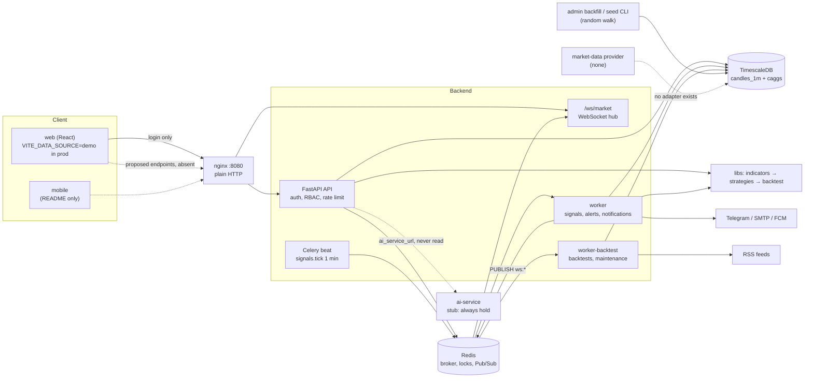
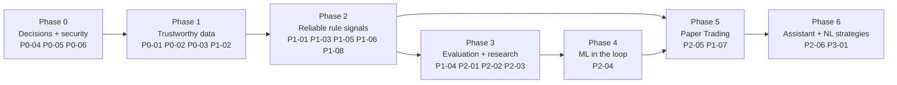

# Repository Audit — AI Trading Engine

Read-only audit of `main` @ `5b91175`, the local checkout, on 2026-10-19. The remote `main` had moved on to
`593cfbf` by then; that commit was not inspected. This version replaces the AI-only audit of 2026-10-18,
which covered the same commit, and widens the scope to security, data, reliability, testing and a full plan.
The shared copy is the doc "AI Trading Engine — Repository Audit"
(https://claude.ai/artifact/XJCecjPXZeAYx7JSSK3Q8L).

Every claim was checked against source unless it is marked **[unverified]**, **[judgment]** (an engineering
opinion) or **[hypothesis]** (needs an experiment). Section 15 says which claims were re-verified by hand and
which came from delegated reading.

**Summary:** the platform shell is well built and tested. The trading engine, however, has no real market
data, no AI and no signal lifecycle, so nothing it outputs today is evidence of anything.

---

## 1. Executive summary

**Maturity: a strong deterministic platform with an empty AI core.**

- **Built, tested and deployed:**
  - auth, RBAC and candle storage;
  - 21 indicators, 6 rule strategies, a no-code strategy Builder and a careful backtester;
  - risk plans, notifications, news, social features and demo payments.
- **Missing:**
  - No component fetches real market data.
  - ai-service is a hard-coded stub.
  - The production website runs entirely on simulated in-browser data, except login.

**Most important findings**

1. **No market data enters the system.** There is no provider adapter anywhere. Candles arrive in only two
   ways: admin upload (`POST /api/v1/admin/instruments/{id}/candles`) or random-walk CLIs (`backend/app/cli.py`,
   `services/seed_service.py`).
2. **ai-service is a placeholder that nothing calls.**
   - `ai-service/app/main.py` always returns `direction="hold"`, `confidence=0.0`, `model_version="placeholder"`.
   - `settings.ai_service_url` (`backend/app/core/config.py:22`) is never read.
   - No manifest contains an ML or LLM dependency.
3. **The live signal engine has no data-quality gate.**
   - It checks only that the closed bar's bucket exists (`services/signal_engine.py:358`), not that the bar is
     complete.
   - A bar with no data at close + 10 s is never retried, and there is no catch-up after downtime.
   - Gaps in the lookback are treated as adjacent bars.
4. **Signals have no lifecycle or outcomes.** `signals` and `signal_plans` have no status, expiry,
   invalidation or TP/SL outcome. Live hit rate and calibration cannot be measured.
5. **FX/gold financial semantics are missing.**
   - Instruments carry no pip, tick or contract size, and no sessions.
   - Sizing treats the account balance as quote-currency units. USD/JPY plans come out about 150× undersized
     and labelled in the wrong currency.
   - Costs are crypto-shaped (a 10 bps fee), and annualisation assumes markets trade 24/7.
6. **Security is mostly solid, with notable gaps.**
   - Production runs on plain HTTP.
   - Signals from private custom strategies are broadcast to all users.
   - WebSocket sessions are never re-authorised.
   - There is no audit log.
7. **The reusable assets are high quality.**
   - `libs/indicators`, `libs/strategies` and `libs/backtest` pass 539 tests and carry tested no-look-ahead
     guarantees.
   - `trading_backtest.run_backtest(df, signals, config)` accepts any signal source, including future ML
     signals.

**Biggest blockers**

- real XAU/USD data with quality checks;
- instrument contract specs;
- a signal lifecycle with outcome tracking;
- the missing "Feature 12" specification that the web client was built against.

**Immediate next step:** build the XAU/USD market-data foundation (P0-01 to P0-03) before any strategy, ML or
Paper Trading work.

---

## 2. Repository inventory

The monorepo has 765 tracked files and 38 commits. Owners, per `README.md`:

- backend, libs and infra: Yazan;
- `ai-service/`: Fadi;
- `web/`: Elias;
- `mobile/`: Batoul.

```text
.
├── .github/workflows/   ci.yml, deploy.yml, backup-offsite.yml, server-inspect.yml
├── ai-service/          FastAPI stub: app/main.py, tests/test_main.py, Dockerfile, notebooks/.gitkeep
├── backend/
│   ├── alembic/versions/ 0001–0012 (linear chain)
│   ├── app/
│   │   ├── api/v1/       ~25 routers + ws.py
│   │   ├── core/         config, security, logging, rate_limit, redis
│   │   ├── services/     market, signal_engine, backtest, risk, strategy_resolver, seed…
│   │   ├── tasks/        Celery app, beat schedule, signals, alerts, news, ops…
│   │   ├── realtime/     Redis Pub/Sub → WebSocket hub
│   │   ├── models/ schemas/ db/
│   │   └── alerts/ chat/ experts/ news/ notifications/ payments/ social/
│   ├── tests/ (42 files)  tests_e2e/ (7 files)  scripts/
├── libs/
│   ├── indicators/       trading_indicators (numpy, TA-Lib parity)
│   ├── strategies/       trading_strategies (6 rules, Builder, Composite)
│   └── backtest/         trading_backtest (engine, risk, metrics)
├── web/                 React 19 + Vite; src/{features,services,domain,fixtures,marketing}; e2e/; docs/ (15 files)
├── mobile/              README.md only (Flutter planned, task T01)
├── infra/               deploy/ (prod compose, deploy/backup scripts), nginx/, loadtest/ (k6)
├── docs/                feature docs, api/ (OpenAPI, AsyncAPI), erd/ (Mermaid), postman/
├── reports for website/ web redesign QA reports + ~130 screenshots (process records)
└── docker-compose.yml, .env.example, README.md (Arabic)
```

| Layer | Technology (from manifests) | Entry point |
| --- | --- | --- |
| Backend API | Python 3.12, FastAPI, SQLAlchemy 2 async + asyncpg, Alembic, pydantic-settings, PyJWT, pwdlib (Argon2) | `backend/app/main.py`; the container CMD runs `alembic upgrade head && uvicorn` |
| Async jobs | Celery with a Redis broker; beat scheduler | `backend/app/tasks/__init__.py` |
| Real-time | WebSocket `/ws/market`, fed by Redis Pub/Sub | `backend/app/api/ws.py`, `backend/app/realtime/hub.py` |
| Database | PostgreSQL 16 + TimescaleDB 2.17.2 | `backend/alembic/versions/` |
| Shared libs | numpy, pandas, pydantic; TA-Lib in dev only | `libs/*/pyproject.toml` |
| AI service | FastAPI, uvicorn, pydantic; no ML libraries | `ai-service/app/main.py` |
| Web | React ^19.2, react-router ^7.9, Vite ^7.1, TypeScript ~5.9, Tailwind ^4.1, zod, lightweight-charts; pnpm | `web/src/app/router.tsx` |
| Web tests | vitest (jsdom), Playwright + axe | `web/vite.config.ts`, `web/playwright.config.ts` |
| Mobile | Flutter planned (README only) | none |
| Deploy | Docker images to GHCR, SSH to one shared VPS, nginx on `:8080` | `.github/workflows/deploy.yml`, `infra/deploy/remote-deploy.sh` |

**Dependency direction:**

- `trading-indicators` ← `trading-strategies` ← `trading-backtest` ← `backend`;
- `web` talks to `backend` over HTTP and WebSocket only;
- `ai-service` depends on nothing in the repo, and nothing depends on it.

---

## 3. Architecture and data flow

- **Entry:** requests come in through nginx.
- **Business logic:** lives in `backend/app/services` and the three libs.
- **Scheduled work:** runs in Celery.
- **Redis:** carries locks, rate limits, and fire-and-forget Pub/Sub to WebSockets.

In the diagram, solid lines are verified in code. Dotted lines are configured but unused, or only planned.



| Component | Responsibility | Evidence |
| --- | --- | --- |
| nginx | Single public entry. Routes `/api/*`, `/ws/*` and `/api/v1/ingest/`, and serves the web client | `infra/nginx/default.conf` |
| API | REST for ~25 resources. Auth and ownership are enforced in `api/deps.py` and per-service `get_own_or_404` helpers | `backend/app/api/v1/*` |
| Signal engine | Every minute, evaluates active (instrument, timeframe) setups on the just-closed bar. Writes `signals`, per-user `signal_plans` and notifications, then publishes to Redis | `services/signal_engine.py`, `tasks/signals.py` |
| Backtests | Queued Celery jobs that call `trading_backtest` on stored candles | `services/backtest_service.py` |
| Candle store | 1m hypertable; 5m/15m/1h/4h/1d hierarchical continuous aggregates with real-time aggregation | `alembic/versions/0003_market_data.py` |
| Realtime | Producers run `PUBLISH ws:<topic>`; each API process fans out to bounded client queues | `realtime/hub.py`, `realtime/topics.py` |
| ai-service | Stateless stub with no nginx route, no healthcheck and no caller | `ai-service/app/main.py`, `infra/deploy/docker-compose.prod.yml` |

**Verified vs inferred.** Every solid line was traced through code. One connection is inferred: that the web
client would work against the backend in `api` mode. The evidence says it would not, because only the auth
paths match (`web/src/services/api/endpoints.ts`: "Everything else is still a PROPOSAL").

**Can the architecture absorb the target engine?** Mostly yes, incrementally **[judgment]**.

- **What fits:** the signal-engine pattern (beat → per-bar job → Redis lock → idempotent insert → publish
  after commit) is the right shape for ML inference and for a signal-lifecycle resolver. The libs are pure
  and reusable offline.
- **What needs new work:**
  - there is no ingestion layer;
  - instruments have no specs;
  - there is no outbox, so events can be lost;
  - signals have no lifecycle state;
  - ai-service has a budget of only 256 MB and 0.5 CPU.

**Coupling and duplication**

- **Indicators exist twice:** Python in `libs/indicators` and TypeScript in `web/src/lib/indicators`. The web
  "AI opportunities" are a client-side heuristic (`web/src/fixtures/opportunities.ts`).
- **Symbol conventions differ.**
  - Backend: `EUR/USD` style, with 3 FX pairs, gold and 5 crypto pairs (`services/seed_service.py:29-39`).
  - Web: `EURUSD` style, with 7 FX pairs and gold, and no crypto (`web/src/domain/instruments.ts:8`).
  - The backend uses snake_case fields; the web uses camelCase.
- **High-risk integration point:** commit-then-publish in `signal_engine.py:387-391` (see section 6).

---

## 4. AI/ML/LLM audit

No AI, ML or LLM functionality is implemented anywhere in the repository.

A case-insensitive search covered: openai, anthropic, claude, gemini, llm, langchain, embedding,
transformers, torch, tensorflow, sklearn, xgboost, lightgbm, catboost, joblib, pickle, onnx, mlflow and shap.
It found only documentation strings, fixtures, and one test asserting that the website does *not* mention
GPT/Claude (`web/src/marketing/cinematic.test.tsx:206`).

| Component | Status | Evidence and limits |
| --- | --- | --- |
| Inference service | Stub | `ai-service/app/main.py` has `GET /health` and `POST /v1/signal {symbol, timeframe}`, which returns a fixed `hold / 0.0 / "placeholder"`. Comment: "Placeholder until the first trained model (F06)". 2 smoke tests |
| Backend → AI call | Not found | `ai_service_url` is defined at `core/config.py:22` and never referenced. ai-service has no nginx route and no production env or healthcheck |
| Training, datasets, labels, features | Not found | Only `ai-service/notebooks/.gitkeep`. `.gitignore` already reserves `mlruns/` and `data/raw/` |
| Model registry / versioning | Not found | No tables in migrations 0001–0012; only the `model_version` string field in the stub |
| Prediction logging and outcomes | Not found | No `predictions` or outcome tables; signals have no outcome either |
| Sentiment | Storage only | `POST /api/v1/ingest/news/sentiment` (label, score in [-1,1], model; `news:write` API-key scope, admin-owned) and `GET /news/sentiment?window=1h\|24h\|7d` exist (`backend/app/news/service.py`). Nothing produces sentiment; `finbert-ft-v1` appears only as an example string |
| LLM / assistant | Not an LLM | `web/src/services/demo/assistant.ts:11-25` is a template "evidence composer" driven by regex intent matching, labelled "Not a language model". The proposed `POST /assistant/replies` does not exist in the backend |
| Client AI contracts | Defined, not implemented | `web/src/domain/opportunity.ts` (`Opportunity`) and `web/src/domain/predictions.ts` (`PredictionRecord`) |

**News inputs.**

- RSS is fetched every 5 minutes from CoinDesk, Cointelegraph and investingLive (seeded in migration 0011).
  There is no gold-specific source and no economic calendar.
- A regex tagger links articles to instruments (`news/tagger.py`, `news/aliases.py`). XAU/USD matches "gold",
  "XAU" and "الذهب".
- Point-in-time features must use the time the system could have known about an article (around
  `fetched_at`), not `published_at`.

**The contract the web client expects: `Opportunity`.**

| Field | Meaning |
| --- | --- |
| `status` | detected / not detected |
| `direction` | long / short / neutral |
| `setupType` | kind of setup |
| `riskLevel` | risk band |
| `probability` | P(TP before SL within the horizon) |
| `confidenceBand` | optional range around `probability` |
| entry / SL / TP | each given as a **zone**, not a single price |
| `riskReward` | reward-to-risk ratio |
| `expectedValueR` | `p·RR − (1−p)` |
| `factors[]` | top-5 attributions |
| `forecast[]` | optional price path |
| `horizonCandles` | horizon length in candles |
| `generatedAt`, `validUntil` | timestamps |
| `modelVersion` | model identifier |
| `provenance` | demo / live |

**`PredictionRecord`** adds `outcome` (tp_hit / sl_hit / expired / open) and `realizedR`. The client computes
hit rate, Brier score and 10-bin calibration itself.

**The gap:**

- The ai-service response (`buy/sell/hold` + `confidence`) matches none of these contracts.
- The proposed `GET /opportunities[/latest]` and `GET /predictions/history` endpoints do not exist in the
  backend.
- The "Feature 12" specification these types cite (about 25 references) is not in the repo.

**Answers to the nine questions**

1. **Real pipeline, wrapper or mock?** A mock. The service is a stub that returns a constant. The web "AI" is
   client-side heuristics plus a template composer.
2. **Can an LLM invoke tools, and what authorisation exists?** No LLM exists, so there is no tool calling and
   no tool authorisation. The web types (`web/src/services/types.ts:84-88`) require a future backend to hold
   the keys and to forbid claims outside the supplied context. Nothing enforces this yet.
3. **Are predictions validated by deterministic logic?** Not applicable today. Rule signals already pass
   through the deterministic `plan_trade` (`libs/backtest/trading_backtest/risk.py`), which is the right place
   to bound any future model output.
4. **Reproducible and traceable to a model version and input data?** No. There is no prediction store.
   Backtests persist config and strategy snapshots, but not a hash of the input candles, and upserts can
   overwrite those candles.
5. **Any training on historical market data?** No evidence. There is no real history to train on.
6. **Are outcomes recorded and evaluated?** No, neither for rule signals nor for predictions (which do not
   exist).
7. **Continuous learning?** Not implemented. Nothing in the code or the schedules.
8. **Can the AI produce unsupported values or bypass rules?** Not today, because nothing consumes AI output.
   The risk appears the moment ai-service is wired in. It stays contained only if two things hold:
   - SL, TP and size remain computed by `plan_trade`;
   - the model supplies only a probability, which a deterministic decision layer thresholds.
9. **What is reusable, missing, or to redesign?**
   - **Reusable:**
     - the indicator library (identical numbers offline and live);
     - the strategies, as candidate generators for meta-labelling;
     - `run_backtest`, for any signal source;
     - `plan_trade`, as the label definition;
     - the signal-engine job pattern;
     - the sentiment ingest API.
   - **Missing:** data, a dataset/label builder, walk-forward evaluation, a model store, prediction and
     outcome tables, and a decision layer.
   - **To redesign:** the ai-service API contract. Align it with `Opportunity` before any model work.

**Hard constraint.** Production gives ai-service 256 MB and 0.5 CPU on a shared 2 vCPU / 8 GB VPS
(`infra/deploy/docker-compose.prod.yml`).

- Training must happen offline.
- Serving must be lightweight, for example linear or gradient-boosted models.
- A ~110M-parameter transformer such as FinBERT will not fit in-process. Score it offline and push the
  results through the existing ingest API. **[judgment]**

**ML design opportunities grounded in the code** **[hypothesis until shown out-of-sample]**

1. **Labels from the platform's own trade plans (triple-barrier).**
   - Define the outcome as P(TP before SL within N bars).
   - Compute it with `trading_backtest` semantics: next-open entry, ATR stop, R-multiple target, stop-first
     on ambiguous bars, and per-instrument costs.
   - The predicted probability then means the same as the plan users receive.
2. **Meta-labelling of the six rule strategies.** A classifier estimates P(success | candidate, context). It
   replaces the heuristic `strength`, and the raw strategy serves as its baseline and as a NO-TRADE filter.
3. **One backtester for everything.** `run_backtest` compares ML signals, rule signals and baselines under
   identical costs.
4. **Shared feature code.**
   - Build on `trading-indicators`, plus closed-bar multi-timeframe context.
   - Add regime features (ATR percentile, ADX, realised volatility) and session/calendar features.
5. **Calibration and abstention.**
   - Calibrate with isotonic or Platt scaling on a chronological hold-out.
   - Decide on EV in R after costs.
   - A lower confidence bound supplies `confidenceBand`.
6. **Explanations.** Tree SHAP on a GBM yields `factors[]`. An LLM may later turn this structured evidence into
   prose, but it must never generate the numbers.

---

## 5. Trading and quantitative logic audit

The deterministic core is careful about look-ahead and well tested, but it was built for 24/7 crypto. Absent
today:

- FX and gold contract semantics;
- sessions;
- multi-timeframe logic;
- ICT/SMC concepts;
- a signal lifecycle;
- Paper Trading.

No profitability claim can be made, because no strategy has been evaluated on real data.

| Capability | Status | How it actually works (evidence) |
| --- | --- | --- |
| Instrument specs | Partial | symbol, source, market, base/quote and price/quantity precision only. No pip, tick, contract or lot size, sessions or spread (`backend/app/models/instrument.py:29-58`) |
| OHLCV and timeframes | Implemented | 1m is the source of truth; 5m–1d are continuous aggregates; UTC, minute-aligned (`models/candle.py`) |
| Bid/ask, spread | Absent | No columns or model |
| Multi-timeframe analysis | Absent | Each evaluation loads one timeframe (`signal_engine.py:349-355`) |
| Indicators | Implemented | 21 registered: sma, ema, wma, macd, adx (also outputs +DI/−DI), supertrend, ichimoku (without chikou), rsi, stoch, stochrsi, cci, williams_r, roc, mfi, atr, bollinger, donchian, keltner, obv, vwap, volume_sma (`libs/indicators/trading_indicators/registry.py`) |
| ICT/SMC / market structure | Absent | No order blocks, FVG, liquidity sweeps, BOS/CHoCH, pivots or killzones. The only "swing" is a rolling min/max stop (`trading_backtest/risk.py:144-151`) |
| Built-in strategies | Implemented | ma_crossover, rsi_reversal, macd_cross, bollinger_reversion, supertrend_flip, donchian_breakout. Signals are closed-bar events, acted on at the next open (`libs/strategies/trading_strategies/strategies.py`) |
| Signal "strength" | Heuristic | The scale differs per strategy (e.g. ADX/50 for ma_crossover). It is not a probability |
| User strategies | Implemented (structured) | Builder JSON: all/any trees, depth ≤ 3, ≤ 50 conditions, 9 operators, Pydantic `extra="forbid"`, no eval/exec (`builder.py`). Composite voting over 2–5 members (`composite.py`) |
| Natural-language strategies | Absent | No parser or LLM |
| SL / TP / trailing | Implemented in backtests; static in live plans | Percent/ATR/swing stops, up to 5 partial targets, trailing with activation and breakeven (`risk.py`). The live `TradePlan` has a single reference entry with a stop and targets |
| Entry zones, activation, invalidation, expiry | Absent | Not in `TradePlan` or `signals` |
| Position sizing | Partial | fraction / fixed / risk / volatility modes, in base units (`trading_backtest/config.py:60-88`) |
| Exposure and loss guards | Backtest only | Max daily loss, max drawdown and cooldown block new entries in the engine. Live plans ignore guards and have no account state |
| Signal lifecycle | Partial | generate → store → per-user plan → notify works. No states or outcomes (`models/strategy.py:84-116`) |
| Backtesting | Implemented | Next-open fills, fees and slippage in bps, gap fills, stop-first on ambiguous bars, R metrics, a determinism test (`trading_backtest/engine.py`) |
| Walk-forward / OOS / optimisation | Absent | No splitter and no parameter search |
| Paper Trading | Absent | No simulated account, order or position |
| Broker / live execution | Absent | "broker" matches only the Celery broker |

**Look-ahead and leakage are mostly well handled (verified).**

- The live engine loads candles with `ts <= bar_time` and aborts if the last row is not that bar
  (`signal_engine.py:349-363`).
- No indicator uses `shift(-n)`, centred windows or backfill. Donchian uses the previous N bars.
- Backtests never fill on the signal bar.
- Tests that append or mutate future bars exist for indicators, strategies, custom strategies, the backtest
  and `plan_trade`.

**Correctness risks**

| ID | Sev | Risk | Evidence | Recommendation |
| --- | --- | --- | --- | --- |
| Q1 | High | The account balance is treated as quote-currency units. A 10,000 USD account on USD/JPY is sized as 10,000 JPY: about 150× too small, with the risk shown in JPY but labelled "USDT". USD-quoted XAU/USD and EUR/USD are unaffected for a USD account | `config.py:60-88`; `RiskProfile.quote_currency` defaults to "USDT" (`models/risk.py:43`) and is never compared with `Instrument.quote_asset` | Add an account currency and quote→account conversion; refuse a plan on mismatch when no rate is available |
| Q2 | High | No contract specification: quantity is in base units (oz, EUR), with no lot or tick rounding; `quantity_precision` is None for FX/XAU | `models/instrument.py`, `services/seed_service.py:29-39` | Add tick_size, contract_size, lot_step, min_qty and pip_size; round stops, targets and size |
| Q3 | High | Partial or missing bars in live evaluation. A 5m–1d bucket is evaluated at close + 10 s even if its last 1m candles are missing. A fully missing bar is released and never retried. There is no catch-up after downtime | `tasks/signals.py:26,215`; `signal_engine.py:53-61,358-364` | Require bar completeness (expected 1m count or a collector watermark); retry `no_data`; catch up N bars as `alerts/engine.py` does |
| Q4 | Medium | Annualisation assumes 24/7 for every market (`SECONDS_PER_YEAR = 365·24·3600`). For FX/gold on hourly bars this overstates Sharpe by about 1.18–1.21× **[judgment: arithmetic]** | `libs/backtest/trading_backtest/metrics.py:37`; `services/backtest_service.py:45` | Derive periods per year from the market calendar |
| Q5 | Medium | Crypto cost model: 10 bps fee + 5 bps slippage, no spread. Live plans use 0 slippage, so planned risk understates the loss at the stop | `trading_backtest/config.py:177-179, 255-258` | A per-instrument cost profile (spread in pips/ticks, commission per lot); include slippage in risk per unit |
| Q6 | Medium | Live and backtest results diverge for path-dependent indicators in Builder rules: VWAP's day anchor and cumulative OBV are computed from a short live window | `signal_engine.py:345-355`; `indicators/registry.py:292-296` | Honour anchors in `history()`; forbid level comparisons on OBV |
| Q7 | Medium | No signal expiry or outcomes: stale plans stay "actionable" indefinitely, and live performance cannot be measured | `models/strategy.py`, `models/risk.py:51-80` | Lifecycle states plus a resolver task (P1-03) |
| Q8 | Medium | Many concurrent signals each size at the full risk %; there is no portfolio exposure limit | `risk_service.plan_dict` → `plan_trade` | Exposure accounting in a Paper Trading ledger |
| Q9 | Low | A backtest range can end inside a forming bar (real-time aggregate) | `backtest_service.py:234`; `market_service.py:233-249` | Clamp `range_end` to the last closed bucket |
| Q10 | Low | No session or weekend calendar. The demo generator emits FX/XAU candles on weekends. 1d buckets cut at 00:00 UTC, while the FX convention is 17:00 New York; 4h buckets are epoch-aligned | `seed_service.py:110-122` | A session calendar per instrument |
| Q11 | Low | Prices and sizes are float64 throughout; plans are rounded to 8 decimals, not to the tick | `TradePlan.to_dict` | Acceptable for analytics; round to the tick on output |

**Unsafe paths from model output to an actionable signal:** none today, because nothing consumes ai-service.
Section 4, question 8, lists the guard that must exist before one is added.

---

## 6. Data and storage audit

PostgreSQL 16 + TimescaleDB is the right engine for this workload and needs no specialised addition. The gaps
are missing tables and missing guarantees, not missing databases.

- **ORM:** SQLAlchemy 2 async with asyncpg.
- **API pool:** 5 connections plus 10 overflow, with a 10 s wait that returns 503 (`backend/app/db/session.py`).
- **Celery:** each task opens a fresh `NullPool` engine (`tasks/signals.py:29-42`).

**Migrations.** A linear Alembic chain, 0001–0012, applied at container start:

| Migration | Creates |
| --- | --- |
| 0001 | TimescaleDB extension |
| 0002 | users, refresh tokens |
| 0003 | instruments, `candles_1m`, continuous aggregates |
| 0004 | user strategies, signals |
| 0005 | API keys |
| 0006 | workspaces |
| 0007 | backtests |
| 0008 | custom strategies |
| 0009 | risk profiles, signal plans |
| 0010 | notifications |
| 0011 | news, social, price alerts |
| 0012 | experts, subscriptions, payments, chat |

The documented policy is additive-only migrations (`docs/deployment.md:266`). No downgrade tests run in CI.

**Candle storage (verified).**

- **Table:** `candles_1m` is a hypertable with 7-day chunks and PK `(instrument_id, ts)`.
- **CHECK constraints:** minute alignment, high/low consistency, volume ≥ 0.
- **Compression:** after 30 days.
- **Aggregates:** 5m/15m/1h/4h derive hierarchically from 1m, and 1d from 1h. All use
  `materialized_only = false`, so reads include the forming bucket.
- **Upserts:** `INSERT … ON CONFLICT DO UPDATE` in 5,000-row chunks. Batches older than 1 h trigger a
  bottom-up aggregate refresh (`services/market_service.py`).
- **Types:** prices are `double precision`; only payments use `NUMERIC(12,2)`.

**Tenancy.**

- Owner columns with `ON DELETE CASCADE` exist on every user resource: strategies, custom strategies,
  backtests, workspaces, risk profiles, signal plans, alerts, notifications, API keys, subscriptions and
  conversations.
- `signals`, `instruments`, `candles_*` and `news_*` are global by design. Because `signals` is global, it
  causes security finding S2.

**Can it hold the target data?**

| Target record | Today | What is needed |
| --- | --- | --- |
| Market data | Table and aggregates ready; no ingestion; no provenance (source, received_at, revision) | A provider column or watermark table; a table for data-quality results |
| Instrument specs | Fields missing | tick, pip, contract, lot, sessions, cost profile |
| Strategy versions | Custom strategies are versioned with snapshot hashes (`custom_strategy_service.py:481-511`) | Reuse as-is |
| Model metadata | None | `model_versions` (artifact hash, training data range, metrics) |
| Signals with lifecycle | No status, expiry or outcome | status, valid_until, invalidation, outcome, realized_r, resolved_at |
| Predictions | None | `predictions`, keyed by model version and input-bar watermark |
| Paper-trading records | None | Accounts, orders, fills and positions per user |
| Reproducible backtests | Config and strategy snapshot stored; candle data not hashed | Store an input-data checksum or watermark |

**Integrity and consistency risks**

- **No outbox (High).**
  - Signals, plans and notification rows commit in one transaction (`signal_engine.py:318-387`), but the Redis
    publish and the Celery enqueue happen after the commit.
  - A failed enqueue leaves deliveries `pending` forever. The code comment says "the pump re-dispatches them"
    (`notifications/service.py:149`), but no such sweeper exists; `_send_one` only fetches by id
    (`:412-427`).
  - A crash between commit and publish loses the WebSocket event and the notifications, because the
    redelivered task's `ON CONFLICT DO NOTHING` returns no rows.
- **No audit trail (Medium).** There is no audit table. Admin role changes, broadcasts, moderation and candle
  writes leave only access-log lines.
- **Missing validation (Low).** No CHECK constraint or schema rule requires prices > 0 or rejects future
  timestamps (`schemas/market.py:92-119`).
- **Retention gaps (Low).**
  - Jobs prune refresh tokens, revoked keys, notifications and news.
  - Nothing prunes signals, plans, backtests or messages.
  - `signals.created_at` is queried daily without an index (`tasks/ops.py:489`).

**Backups.**

- **Local:** a daily `pg_dump` at 03:17, kept for 7 days on the same VPS (`infra/deploy/backup.sh`).
- **Off-site:** a daily workflow encrypts the newest dump, restore-tests it in a fresh TimescaleDB container,
  and keeps it for 14 days as a GitHub artifact (`.github/workflows/backup-offsite.yml`).
- **No WAL archiving:** the recovery-point objective is up to 24 hours.
- **Redis:** no persistence configuration and no `maxmemory`, under a 192 MB limit. Yet it serves as the
  broker, the lock store and the ETA queue (`docker-compose.prod.yml:44-54`).

---

## 7. Security and privacy findings

REST ownership checks are consistent. Every user-owned resource is fetched through an owner-filtered helper
that returns 404, and no IDOR was found in any router. The serious issues are three:

- transport security;
- a cross-tenant signal broadcast;
- the lifetime of WebSocket sessions.

No secret values appear below.

| ID | Sev | Finding | Evidence | Impact | Remediation |
| --- | --- | --- | --- | --- | --- |
| S1 | High | Production serves plain HTTP; no TLS or HSTS | `infra/nginx/default.conf:24` (`listen 80`); the prod compose publishes `8080:80` | Passwords, JWTs, API keys and the WS `?token=` travel in cleartext | Domain + TLS (443, redirect 80), HSTS, https CORS origins |
| S2 | Medium | Signals from private custom strategies are visible to all users | `signals` has no owner. `GET /signals` without `mine` is unfiltered (`services/strategy_service.py:240-284`, verified). The engine publishes on `signals:{instrument_id}`, which any authenticated client can subscribe to. Builder `details` expose rule operands | Reveals that a private strategy is running and part of its rules; contradicts `strategy_resolver.py:5-6` | Filter `custom:*` signals by `can_use`; send private ones only on `user:{id}`; strip `details` for non-owners |
| S3 | Medium | The paywalled expert signals feed is readable for free | The same `Signal` rows are returned by `GET /signals?strategy_key=custom:<id>`, and the key is discoverable through `/custom-strategies/public` (`experts/service.py:275-305`) | Paid perk bypass (payments are demo-only today) | Gate perk-linked strategies by entitlement |
| S4 | Medium | WebSocket sessions are authorised once and never re-checked | `api/ws.py:56-81`; API keys without an expiry get `expires_at=inf` (`:79`) | A revoked API key streams indefinitely; a deactivated user streams for up to 30 min | Revalidate on heartbeat; a revocation event closes sessions |
| S5 | Medium | Insecure defaults unless `ENVIRONMENT` is exactly `production` | `core/config.py:115,118`; `.env.example` has a placeholder JWT secret; the checks run only in production (`:241-250`) | A misconfigured deploy runs with a known signing secret, open docs and demo tools. The VPS is mitigated because `remote-deploy.sh` generates secrets | Require a strong secret in every non-test environment |
| S6 | Low–Med | JWTs committed in the API docs | `docs/postman/AI-Trading-Platform.postman_collection.json` and `docs/postman/tools/examples.json` (values redacted): refresh tokens with `exp` 2026-10-31 (not yet expired) and an expired expert-role access token, captured against localhost | Usable only if signed with a secret still in use, which is unknown | Replace with placeholders; revoke that user's refresh tokens |
| S7 | Low | The WS `signals`/`candles` topics need only the `stream` scope, not `signals:read` | `api/ws.py:252-259` | The scope model is not enforced on streams | Require matching read scopes |
| S8 | Low | No email verification or password reset | grep; `notifications/channels/email.py:2` | Unverified addresses receive mail; no account recovery | Verification and single-use reset tokens |
| S9 | Low | Targeted lockout: 10 failures in 15 min lock the account, even against the correct password | `api/limits.py:166-170` | Anyone can lock a known account repeatedly | Combine with IP/device signals, or use a CAPTCHA |
| S10 | Low | Access tokens survive logout and password change (≤ 30 min) | `core/security.py:38-48` | A window for stolen tokens | A `token_version` claim |
| S11 | Low | The Telegram webhook secret is compared with `!=` | `api/v1/notifications.py:223-224` | A theoretical timing leak | `hmac.compare_digest` |
| S12 | Low | Registering an existing FCM token moves it to the caller | `api/v1/notifications.py:253-261` | Push redirection if a token leaks | Require device re-auth |
| S13 | Low | No backend lockfile (`>=` ranges); containers run as root | `backend/pyproject.toml`; the Dockerfiles have no `USER` | Non-reproducible builds; a larger blast radius | `uv.lock` or hashed requirements; a non-root user |
| S14 | Low | The web client stores access and refresh tokens in localStorage | `web/src/app/AppProviders.tsx:91-96` (acknowledged in `web/docs/KNOWN_ISSUES.md` #9) | XSS would steal sessions | An httpOnly refresh cookie, or a strict CSP (pages have none today) |
| S15 | Info | Admins can read every private chat | `chat/service.py:97-102` | A privacy-sensitive power, unlogged | Audit-log admin reads |

**Done well (verified)**

- Argon2 password hashing with a timing-safe dummy hash.
- Refresh-token rotation with reuse detection.
- The JWT algorithm is pinned on decode, and `type`/`exp` are required.
- API keys store only SHA-256 hashes, are compared in constant time, are scoped, and are barred from admin
  routes.
- Role and `is_active` are re-read from the DB on every request.
- Self-registration always creates a trader.
- No `eval`/`exec` on user input: Builder strategies are validated data. No SQL is built from user strings.
- Redis GCRA rate limiting on all `/api/v1` routes. It fails open, except login, which fails closed.
- Wildcard CORS is refused, and API docs are off in production.
- Logs are redacted, and CI scans test logs for secrets.
- `pip-audit` and `bandit` run in CI.
- No SSRF surface: RSS URLs are admin-seeded.

**LLM-specific exposure:** none today. When an assistant or a natural-language strategy parser is added:

- treat user text, news and RSS content as untrusted input to the model;
- the model must not hold credentials;
- every tool it can call must re-check the caller's ownership server-side.

---

## 8. Reliability, performance and deployment

The architecture cannot yet safely run continuous market monitoring. Nothing stops stale, partial or gapped
data from producing an actionable signal, and nothing alerts when it happens. The job machinery itself is
sound (locks, unique keys, `acks_late`).

**Scheduling and idempotency (verified).**

- **Beat schedule** (`backend/app/tasks/__init__.py`):
  - `signals.tick` and `alerts.tick` every minute;
  - `news.fetch` every 5 min;
  - backtest recovery every 5 min;
  - subscription renewal every 10 min;
  - nightly cleanup.
- **Signal deduplication** uses three layers: a Redis `SET NX` lock (120 s TTL), a 6 h "done" marker, and the
  `uq_signals_bar` unique key.
- **Catch-up:** price alerts re-check the previous 4 bars after downtime. **Signals do not**:
  `signal_engine.closed_bars` returns only the bars that close at the current minute.

**Data freshness.** The only guard is `candles[-1].ts != job.bar_time` → `no_data`, which is logged at INFO
and not retried. Market lag per instrument is visible in `GET /admin/system/status`
(`services/system_status.py:121-137`). Nothing alerts on it, and nothing stops signal generation.

| Area | State | Evidence |
| --- | --- | --- |
| Logging | JSON in production, `X-Request-ID` per request, secret redaction | `core/logging.py`, `api/middleware.py` |
| Metrics, tracing, error tracking | Not found (no Prometheus, OpenTelemetry or Sentry) | grep |
| Health | `/health` is static. `/health/ready` checks DB and Redis but always returns HTTP 200, even when degraded (verified) | `api/v1/health.py:23-39` |
| Container healthchecks | db, redis and backend only; none for workers, beat, ai-service or nginx | `infra/deploy/docker-compose.prod.yml` |
| Timeouts | Outbound HTTP has a 10 s timeout, backoff and a circuit breaker. No DB `statement_timeout`, no Redis socket timeout, and no Celery time limit on `signals.evaluate` | `notifications/`, `db/session.py`, `core/redis.py` |
| Event delivery | Redis Pub/Sub with no persistence, and no sequence numbers or backfill for signals | `realtime/hub.py`, `docs/websocket.md` |
| Resource limits | Set on every prod service; ai-service has 256 MB / 0.5 CPU | prod compose |
| CI/CD | On PR and on main: lint, format, ERD/OpenAPI/AsyncAPI drift checks, backend pytest against real TimescaleDB + Redis, a lib matrix on 3.10/3.12, web typecheck/lint/vitest/build, compose e2e, pip-audit, bandit. Deploy: GHCR images by SHA, SSH, readiness check, automatic image rollback | `.github/workflows/ci.yml`, `deploy.yml` |
| Rollback | Images roll back; migrations do not (mitigated by the additive-only policy) | `infra/deploy/remote-deploy.sh:103-107` |
| Environments | Development and production only, on one shared VPS; no staging | `core/config.py`, `docs/deployment.md` |
| Runbooks | Deploy, backup/restore and capacity notes. No incident runbooks (stale data, Redis loss, stuck queues) | `docs/deployment.md` |

**Performance.** No performance targets are verified.

- `infra/loadtest/README.md` records single k6 runs on a 16-CPU Windows Docker Desktop host, not on the 2-vCPU
  VPS.
- Its figures are claims from the docs and were not reproduced **[unverified]**:
  - about 40 req/s;
  - p95 of 7.8–9.0 s;
  - 2–6% 503 responses from pool exhaustion at 200 virtual users.
- Latency and throughput for signal generation are unmeasured.

---

## 9. Testing and verification results

All four Python suites that need no external services passed, and lint is clean. The backend, e2e and web
suites were not run.

How the commands ran:

- in a pre-existing Python 3.12.15 virtualenv from an earlier session (no packages installed);
- with `PYTHONDONTWRITEBYTECODE=1` and `-p no:cacheprovider`, so the working tree was unchanged.

`git status` afterwards showed only the pre-existing untracked `ai-service/docs/`.

| Command (run from the directory shown) | Ran | Exit | Result |
| --- | --- | --- | --- |
| `libs/indicators`: `python -m pytest -q -p no:cacheprovider` | Yes | 0 | 221 passed, 1 skipped |
| `libs/strategies`: same | Yes | 0 | 187 passed |
| `libs/backtest`: same | Yes | 0 | 131 passed |
| `ai-service`: same | Yes | 0 | 2 passed, 1 deprecation warning (starlette TestClient) |
| `ruff check --no-cache backend` / `libs` / `ai-service` | Yes | 0 | All checks passed |
| `backend`: `pytest` | No | — | Needs live TimescaleDB and Redis (`backend/tests/conftest.py:14-32`); starting containers would change state |
| `backend/tests_e2e` | No | — | Needs the full compose stack |
| `web`: `pnpm test`, `pnpm typecheck`, Playwright | No | — | No `node_modules` present; installing was out of scope |

Caveat: the venv's package versions (for example pandas 3.0.6, numpy 2.5.4) come from unpinned `>=` ranges and
may differ from what CI resolves.

**Test inventory.** Counts are static counts of test functions; parametrised cases add more.

| Location | Framework | Files | Tests | Covers |
| --- | --- | --- | --- | --- |
| `backend/tests` | pytest + asyncio, real DB/Redis | 42 | ~467 | API, auth, RBAC, API keys, rate limits, WS, signal engine (incl. forming-bar exclusion, locks), risk, backtests, alerts, migrations, log-secret scan, pool exhaustion |
| `backend/tests_e2e` | pytest via nginx | 7 | 8 | Ordered end-to-end scenario |
| `libs/indicators/tests` | pytest | 5 | 30 | Hand-computed values, TA-Lib parity, no look-ahead |
| `libs/strategies/tests` | pytest | 7 | 78 | Builder, Composite, validation, no look-ahead |
| `libs/backtest/tests` | pytest | 5 | 67 | Fills, fees to the cent, stop-first, gaps, sizing, guards, metrics, determinism |
| `ai-service/tests` | pytest | 1 | 2 | Smoke |
| `web/src/**/*.test.ts(x)` | vitest | 16 | ~152 | Domain maths, risk, HTTP contract, assistant, components |
| `web/e2e` | Playwright + axe | 7 | ~43 | Flows, accessibility, visual; **not run in CI** |

**Not covered anywhere:**

- ML evaluation (none exists);
- FX/JPY/XAU sizing semantics;
- annualisation for markets that don't trade 24/7;
- late or partial candles in the signal engine;
- data-quality rules beyond input validation;
- recovery after beat downtime;
- security tests for cross-tenant signal visibility (S2).

---

## 10. Target-state gap analysis

Of the 17 target capabilities:

- four are implemented or nearly so;
- eight are partial;
- five are absent: ingestion, data quality, ML, LLM and Paper Trading.

The backlog IDs refer to section 11.

| # | Capability | Status | Reusable today (evidence) | Missing | Impact | Next step |
| --- | --- | --- | --- | --- | --- | --- |
| 1 | Market-data ingestion | Absent | Idempotent `upsert_candles`, aggregates, the admin backfill endpoint (`market_service.py`) | Provider adapters, historical backfill, live polling | Blocks everything | P0-01 |
| 2 | Data quality, safe-stop | Absent | Input CHECKs; `lag_seconds` in system status | Completeness, gap, outlier and staleness checks; stopping signals on failure | Unsafe signals | P0-02 |
| 3 | Multi-timeframe analysis | Partial | All 6 timeframes stored and queryable | Strategies and an engine that read several timeframes at once | No scalping context | P2-01 |
| 4 | Technical and ICT/SMC framework | Partial | 21 indicators, 6 strategies, a `Strategy` base class with `history()` | Market structure, sessions, killzones, liquidity concepts | Core product promise | P2-02 |
| 5 | Structured custom strategies | Implemented (structured) | Builder + Composite: validated, versioned, no eval | Natural-language → Builder translation | Feature gap only | P2-06 |
| 6 | ML train / infer / evaluate / version | Absent | `run_backtest` for any signal source; `plan_trade` defines TP/SL labels | Dataset builder, labels, walk-forward, model store, serving | No AI | P2-03, P2-04 |
| 7 | LLM orchestration, tool auth | Absent | The web contract for `/assistant/replies` and a safe Markdown renderer | Backend endpoint, provider, tool permissions, grounding | Feature gap | P3-01 |
| 8 | Decision and risk engine | Partial | `plan_trade`, risk templates, sizing modes, backtest guards | Instrument specs, currency conversion, live exposure limits, abstain logic | Wrong sizes | P0-03, P1-02 |
| 9 | Signal generation and lifecycle | Partial | An engine with locks, idempotent inserts, per-user plans, notifications | States, expiry, invalidation, entry zones, an outcome resolver | Performance unmeasurable | P1-03 |
| 10 | User settings, tenant isolation | Implemented, one leak | Owner checks on every router; per-user risk profiles and plans | Private-signal isolation (S2/S3) | Privacy | P0-04 |
| 11 | Backtesting, OOS validation | Partial | A high-quality engine with tested no-look-ahead | Walk-forward splitter, FX costs, calendar annualisation, data hash | Inflated metrics | P1-04 |
| 12 | Paper Trading | Absent | Signal plans as order intents; backtest fill semantics | Accounts, orders, fills, positions, P&L | Phase-2 goal | P2-05 |
| 13 | Real-time APIs and delivery | Partial | `/ws/market`, Redis Pub/Sub, the AsyncAPI spec; REST for signals and plans | Outbox, event ids and backfill. The web client polls and uses demo data | Lost events | P1-05, P1-07 |
| 14 | Audit trail, reproducibility | Partial | Strategy snapshots and hashes; persisted backtest config | Audit log; prediction and data provenance | Not traceable | P1-06 |
| 15 | Monitoring, alerting, recovery | Partial | JSON logs, request ids, a system-status endpoint, a daily restore test | Metrics, alerts, readiness 503, worker healthchecks, signal catch-up | Silent failure | P1-01, P1-08 |
| 16 | Security, permissions | Mostly implemented | Argon2, JWT rotation, scoped API keys, RBAC, rate limits | TLS, WS revalidation, secret defaults | Credential theft | P0-05 |
| 17 | Deployment, automated tests | Implemented | Full CI, GHCR deploy with rollback, restore-tested backups | Staging, web e2e in CI, a backend lockfile, non-root images | Moderate | P1-08, P3-04 |

---

## 11. Prioritized backlog

P0 items must land before the work that depends on them. Effort is relative (S, M, L, XL) because team
capacity is unknown. Owners are suggestions, taken from the README ownership table, and need agreement.

### P0 — Critical

| ID | Item and rationale | Modules | Depends on | Acceptance criteria and tests | Effort | Risks / unknowns |
| --- | --- | --- | --- | --- | --- | --- |
| P0-01 | **XAU/USD market-data adapter and backfill.** No data exists (section 1, finding 1) | New `backend/app/marketdata/` (or `ai-service`, per decision 2 in section 13); `services/market_service.upsert_candles`; `tasks/` | P0-06 decision on the provider | Multi-year 1m (or the agreed base TF) XAU/USD history is loaded. A live poller keeps lag below an agreed threshold. Provider, price basis (bid/mid/last) and received_at are recorded. Tests: adapter contract tests on recorded fixtures, idempotent re-run, timezone handling | L | Provider limits and licence; bid vs mid basis |
| P0-02 | **Data-quality gate and safe-stop.** The engine evaluates partial bars and ignores gaps (Q3) | `services/signal_engine.py`, `tasks/signals.py`, new `services/data_quality.py` | P0-01 | A bar is evaluated only if it is complete (expected 1m count or a watermark) and its lookback has no unexpected gaps outside the session calendar. Otherwise a `data_quality_failed` status is recorded and no signal is produced. `no_data` is retried within a window, and missed bars are caught up after downtime. Tests: late, missing, duplicate and weekend candles; a beat outage | M | Defining expected gaps needs the session calendar (P1-02) |
| P0-03 | **Instrument specs and currency-correct sizing.** USD/JPY is ~150× mis-sized, and there are no lots or ticks (Q1, Q2) | `models/instrument.py` + migration, `libs/backtest/trading_backtest/config.py` `Sizer`, `risk.py` `plan_trade`, `services/risk_service.py` | — | Instruments carry tick, pip, contract size, lot step and min qty. Plans are rounded to tick and lot. The account currency is converted, and a mismatch without a rate refuses the plan. Tests: hand-computed XAU/USD (100 oz), EUR/USD and USD/JPY cases | M | Rate source for conversion |
| P0-04 | **Isolate private-strategy signals.** Cross-tenant leak and paywall bypass (S2, S3) | `services/strategy_service.list_signals`, `signal_engine._publish`, `api/ws.py`, `experts/service.py` | — | A user without `can_use` on a `custom:*` key sees none of its signals via REST or WS, and `details` are stripped for non-owners. Tests: two-user REST and WS isolation tests | S | Existing clients that rely on the global feed |
| P0-05 | **Transport and session security.** HTTP in prod, WS sessions never revalidated, secret defaults, committed tokens (S1, S4, S5, S6) | `infra/nginx`, `infra/deploy`, `api/ws.py`, `core/config.py`, `docs/postman/*` | A domain name (infrastructure decision 3) | HTTPS only, with HSTS. A revoked key or deactivated user is disconnected within one heartbeat. The app refuses the default secret outside `test`. No live tokens remain in the docs. Tests: a WS revocation test; a config validation test | M | Who owns ports 80/443 on the shared VPS |
| P0-06 | **Close the specification gap.** The web client was built against a "Feature 12" spec and an F-task list that are not in the repo | `docs/` | Team | The spec and task list are committed. The Opportunity contract is agreed by the AI, backend and web owners. The v1 instrument, timeframe and horizon are decided (section 13) | S | Team availability |

### P1 — Foundation for a reliable signal MVP

| ID | Item and rationale | Modules | Depends on | Acceptance criteria and tests | Effort | Risks / unknowns |
| --- | --- | --- | --- | --- | --- | --- |
| P1-01 | **Monitoring and alerting.** Readiness returns 200 when degraded, and nothing alerts | `api/v1/health.py`, prod compose, `core/ops.py` | — | `/health/ready` returns 503 when degraded. Workers and beat have healthchecks. Alerts fire on market lag, beat staleness, queue depth and 5xx. Tests: a readiness unit test | S | Choice of alert channel |
| P1-02 | **FX/gold market model.** Sessions, cost profile, calendar annualisation (Q4, Q5, Q10) | `models/instrument.py`, `trading_backtest/{config,metrics}.py`, `services/backtest_service.py` | P0-03 | Per-instrument spread and commission; a session calendar with weekends; periods per year from the calendar; slippage included in planned risk. Tests: Sharpe on a known FX series; weekend gap handling | M | Spread varies by session and around news |
| P1-03 | **Signal lifecycle and outcome resolver.** No states or outcomes (Q7) | `models/strategy.py`, `models/risk.py`, migration, new `tasks/resolver.py` | P0-02 | States pending → active → tp_hit / sl_hit / expired / invalidated, with `valid_until` and `realized_r`. The resolver uses backtest semantics on closed bars (stop-first on ambiguous bars). Tests: hand-built bar sequences for each outcome; parity with `trading_backtest` | M | Defining activation for zone entries |
| P1-04 | **Walk-forward evaluation harness.** No OOS validation, and the data is not hashed | `libs/backtest`, `services/backtest_service.py` | P1-02 | Chronological splits with purge and embargo. Results include a data checksum and the config, with a report per fold. Tests: no-overlap property tests for splits; a reproducibility test | M | — |
| P1-05 | **Outbox or sweeper for events.** Notifications and WS events can be lost (section 6) | `notifications/service.py`, `signal_engine.py`, beat schedule | — | Pending deliveries older than 2 min are re-dispatched. A crash between commit and publish does not lose notifications. Tests: failure-injection tests for an enqueue failure and a worker crash | S | Duplicate sends (dedupe keys exist) |
| P1-06 | **Audit log and provenance.** There is no audit trail | New `audit_log` table, admin routers | — | Admin and security actions are recorded with actor, action, target and request id. Tests: an admin action produces a row | S | — |
| P1-07 | **Web integration of real signals.** The production web client runs with `VITE_DATA_SOURCE=demo` | `web/src/services/api/*`, backend routers | P0-06, P1-03 | Signals, plans and candles are served from the backend in `api` mode, and the symbol format is reconciled. Tests: contract tests via the zod schemas; Playwright in CI | L | Web owner capacity |
| P1-08 | **Operational hardening.** Redis persistence, timeouts, non-root containers, a lockfile (sections 6–8) | prod compose, Dockerfiles, `db/session.py`, `core/redis.py`, `backend/pyproject.toml` | — | Redis AOF with `noeviction`; a DB statement timeout; a Celery time limit on `signals.evaluate`; non-root containers; locked dependencies. Tests: a compose config check in CI | M | Shared-server constraints |

### P2 — MVP expansion

| ID | Item | Depends on | Acceptance criteria (abridged) | Effort |
| --- | --- | --- | --- | --- |
| P2-01 | Multi-timeframe context for strategies (closed higher-TF bars only) | P0-02 | Higher-TF values align to the last *closed* higher bar; no-look-ahead tests | M |
| P2-02 | Deterministic ICT/SMC and session primitives as a library: swing pivots with confirmation lag, BOS/CHoCH, FVG, liquidity sweeps, killzones | P1-02 | Each primitive has hand-built tests and an append-future-bars no-look-ahead test, and a documented confirmation delay | L |
| P2-03 | ML research foundation in `ai-service`, run offline: a point-in-time dataset builder, triple-barrier labels from `plan_trade`, walk-forward with purge/embargo, and baselines (base rate, raw rules, logistic regression) | P0-01, P1-04 | A reproducible run from config + data hash. Brier score, log loss, calibration and after-cost trading metrics per fold | L |
| P2-04 | Model serving and prediction store: an ai-service endpoint matching `Opportunity`; `model_versions` and `predictions` tables; a deterministic decision layer (EV threshold, abstain) | P2-03, P1-03 | Every prediction is traceable to a model version and an input watermark. SL/TP/size always come from `plan_trade`. The resolver records outcomes | L |
| P2-05 | Paper Trading ledger: per-user accounts, simulated orders, fills, positions, exposure limits | P1-03, P0-03 | Fills follow backtest semantics. P&L and exposure are tracked per user. Strict tenant tests | L |
| P2-06 | Natural-language → Builder translation: the LLM proposes Builder JSON, the existing validator decides, and the user confirms | LLM provider decision (section 13) | Invalid output is never saved; a prompt-injection test set | M |

### P3 — Later

| ID | Item | Depends on | Effort |
| --- | --- | --- | --- |
| P3-01 | An evidence-grounded LLM assistant with server-side tool authorisation, cost controls and timeouts | P2-04 | L |
| P3-02 | Sentiment and economic-calendar features, scored offline and pushed via the ingest API; kept only if ablations show value | P2-03 | M |
| P3-03 | Additional FX instruments | P0-01, P1-02 | M |
| P3-04 | A staging environment, point-in-time-recovery backups, Playwright in CI, scale work | — | M |
| P3-05 | Live-execution readiness (broker abstraction, kill switch): a separately authorised future phase | P2-05 + evidence | XL |

---

## 12. Phased implementation roadmap

There are seven phases (0–6). Each is gated by evidence rather than by dates.

- Signals and Paper Trading come first; live execution stays out of scope.
- Research and training run offline (Colab, Kaggle or local), never on the shared VPS. This keeps heavy work
  away from the user-facing API.



| Phase | Goal | Reuse | Genuinely new | Exit criteria | Main risk |
| --- | --- | --- | --- | --- | --- |
| 0. Decisions and security | Agree what is being built; close the transport and tenancy holes | Existing auth, `can_use`, nginx | Spec docs; TLS config; WS revalidation | Spec committed; HTTPS live; S2/S4 isolation tests green | Time needed for team alignment |
| 1. Trustworthy data | Real XAU/USD history and a live feed that cannot silently degrade | `upsert_candles`, aggregates, admin backfill | An adapter, a data-quality service, instrument specs, a session calendar | Multi-year history loaded; quality report clean or explained; the engine refuses incomplete bars in tests | Provider limits and cost |
| 2. Reliable rule signals | Signals with a lifecycle, outcomes and no lost events | Signal engine, `plan_trade`, notifications | Lifecycle columns, a resolver task, a sweeper, an audit log, alerts | A forward run of the 6 rule strategies on live XAU/USD, with every signal resolved and no orphaned deliveries | Lifecycle semantics for zone entries |
| 3. Evaluation and research | Leak-free walk-forward evidence, with baselines before models | `run_backtest`, indicators, strategies as candidates | A walk-forward harness, a dataset/label builder, ICT/SMC primitives, MTF context | A baseline report per fold after costs. Any model must beat the baselines out-of-sample to continue | No edge found (a valid outcome) |
| 4. ML in the loop | Serve calibrated probabilities through a deterministic decision layer | The phase-2 lifecycle and resolver; `plan_trade` | An ai-service `Opportunity` endpoint, model and prediction tables | Every prediction is traceable; live calibration is tracked; the model never sets SL/TP/size | The 256 MB / 0.5 CPU budget |
| 5. Paper Trading | Simulated execution per user, with exposure limits | Backtest fill semantics, signal plans | Ledger tables and service; web integration | Paper P&L reconciles with a replayed backtest on the same bars | Fill realism (spread, slippage) |
| 6. Assistant and NL strategies | Grounded explanations; NL → validated Builder JSON | Builder validator, the web assistant contract | An LLM gateway with tool authorisation | The injection test suite passes; replies contain no ungrounded numbers | Prompt injection, cost |

Phase 5 can start after phase 2 using rule signals only, so Paper Trading does not wait on ML. Section 11 gives
the files, tests and acceptance criteria for each item.

---

## 13. Open questions and decisions

These cannot be answered from the repository. The first three questions under each heading block Phase 1.

**Product decisions**

1. Can the "Feature 12" specification and the F-task list (F01…F19, AI 13/18/19) be committed? The web
   contract cites them about 25 times.
2. Which timeframe and horizon for v1?
   - The brief says Scalping comes first, which implies 1m–15m.
   - The web demo assumes 15m/1h/4h with a 20-bar horizon.
   - The two need different data granularity and cost assumptions.
3. Which instruments come after XAU/USD?
   - The backend seeds 3 FX pairs plus 5 crypto pairs.
   - The web lists 7 FX pairs and no crypto.
   - Is crypto still in scope?
4. What exactly is an "entry zone", and what is an "activation condition" in a signal (a limit order, a touch,
   a close inside the zone)? When does an unactivated signal expire?
5. Should the probability shown to users be P(TP before SL within the horizon), as the web contract defines?
   What minimum evidence (out-of-sample period, number of resolved signals) is required before a model
   probability is shown at all?
6. Should a user's signal history include signals from public strategies they did not run, or only their own?
   This affects P0-04.

**Infrastructure decisions**

1. Which market-data provider and plan for XAU/USD? Which source for multi-year history and which for live,
   and is the price basis bid, ask or mid?
2. Is the data adapter (F01) an AI-side or a backend task, and does it live in `backend` or in `ai-service`?
3. Is a domain name available for TLS on the shared VPS, and who controls ports 80/443 there?
4. Which training compute: Colab, Kaggle, a local GPU, or CPU only?
5. Can ai-service's production budget (256 MB / 0.5 CPU) be raised if a model needs it, or must serving fit
   as-is?
6. If Phase 6 proceeds: which LLM provider, what budget, and what data-handling constraints?

---

## 14. Recommended first implementation task

**Build a provider-agnostic historical candle importer with a data-quality report, and use it to load XAU/USD
1m history.** This is the first slice of P0-01 and P0-02. It can start before the live-provider decision,
because it reads files in one documented schema.

**Scope**

- An `Adapter` interface (fetch a time range of 1m bars for an instrument) with one implementation: a
  CSV/Parquet file loader with an explicit column map, timezone and price basis.
- A pure `data_quality` module. Given 1m bars and an instrument's session calendar, it reports:
  - duplicates and OHLC violations;
  - non-positive prices and future timestamps;
  - gaps inside trading hours, kept separate from expected weekend and holiday gaps;
  - outlier returns relative to recent volatility.
- A CLI command, for example `python -m app.cli import-candles --instrument XAU/USD --file … --strict`. It
  validates the file, prints the report, and writes through the existing `market_service.upsert_candles`. With
  `--strict`, any blocking issue means zero rows are written.
- A minimal XAU/USD session calendar (Sunday open to Friday close, plus the daily maintenance break), stored
  with the instrument or in code until P1-02.

**Non-goals:** live polling, signal-engine changes, instrument contract specs (P0-03), ML, web changes.

**Relevant modules**

- `backend/app/services/market_service.py`: reuse `upsert_candles` and its aggregate refresh.
- `backend/app/cli.py`.
- `backend/app/models/instrument.py`.
- `backend/app/schemas/market.py`: reuse the `CandleIn` rules.

Placing this in `backend` is a recommendation pending infrastructure decision 2; it keeps ai-service
stateless.

**Acceptance criteria**

- Importing the same file twice leaves identical rows (idempotent).
- The report's counts exactly match a fixture with known injected defects.
- Weekend gaps are not reported as defects; a missing Tuesday hour is.
- Strict mode writes nothing when a blocking defect exists. Non-strict mode writes the valid rows and records
  the report.
- After the import, the `candles_1h` and `candles_1d` aggregates cover the imported range.

**Required tests**

- Pure unit tests for every quality rule on hand-built frames, including DST transitions and rejection of
  timezone-naive input.
- An integration test against the existing TimescaleDB test fixture (`backend/tests/conftest.py`): import,
  re-import, aggregate refresh.
- A no-mutation test: a failed strict import changes no rows.

**Why this goes first.** Every downstream item consumes these candles: strategy evaluation, the lifecycle
resolver, walk-forward results, ML labels and Paper Trading fills. Today they would all run on a random walk,
which is unpredictable by construction. The quality rules written here are the same ones the live safe-stop
(P0-02) needs, so none of this work is thrown away. The security items P0-04 and P0-05 are independent and can
run in parallel under the backend owner.

---

## 15. Audit limitations

The audit covers only the local checkout of `5b91175`. It modified, installed and deployed nothing; the only
file changes are these two docs, updated afterwards on request.

**Scope and method**

- **Remote state not inspected.** A read-only `git fetch --dry-run`, run early to check freshness, contacted
  GitHub. It showed that `origin/main` had moved to `593cfbf` and that a `b/T01-mobile-app` branch exists.
  No refs or objects were updated, and neither was inspected. This was the only external network access.
- **Delegated reading.** Breadth reading of the backend routers, migrations, web client and infrastructure
  was split across four read-only review agents.
  - The highest-impact claims were re-verified directly in source:
    - the ai-service stub and its absent callers;
    - closed-bar selection and the missing `no_data` retry;
    - the missing notification sweeper;
    - readiness returning 200;
    - unconverted sizing units;
    - the unfiltered `GET /signals`;
    - the indicator count (21, from the registry);
    - the JWT expiry dates (only the claims were decoded; values were never printed).
  - Other file:line references come from those agents' reading and were not each re-opened.
- **Not inspected in depth:**
  - web marketing and motion code;
  - `reports for website/`;
  - Postman tooling scripts;
  - notification templates;
  - the Arabic-language sections of `README.md` and `docs/deployment.md`, beyond the parts cited.

**Commands not executed**

- Backend pytest and e2e: they need TimescaleDB, Redis and Docker containers.
- Web vitest, typecheck and Playwright: no `node_modules`, and installing was out of scope.
- Load tests and restore tests.
- Anything against the production server.

**Unverified**

- Runtime behaviour of hierarchical real-time aggregates at bucket edges.
- Upsert performance into compressed chunks.
- Whether redis-py resubscribes the hub after a reconnect.
- The production `.env` and the server cron.
- Which secret signed the committed Postman tokens.
- All load-test and restore figures quoted from docs.
- Strategy profitability: not assessed and not claimed.
