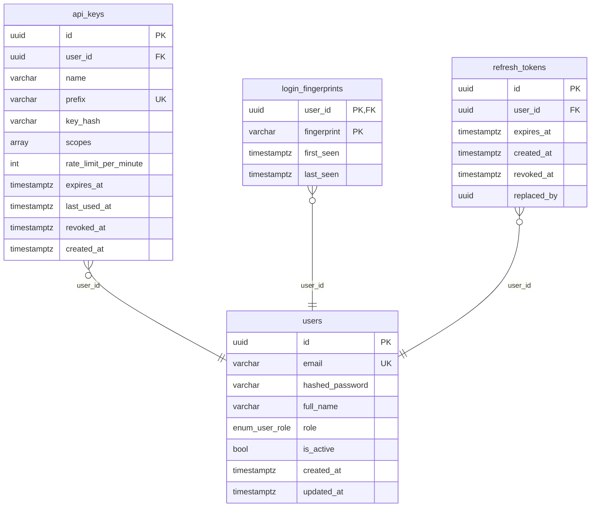
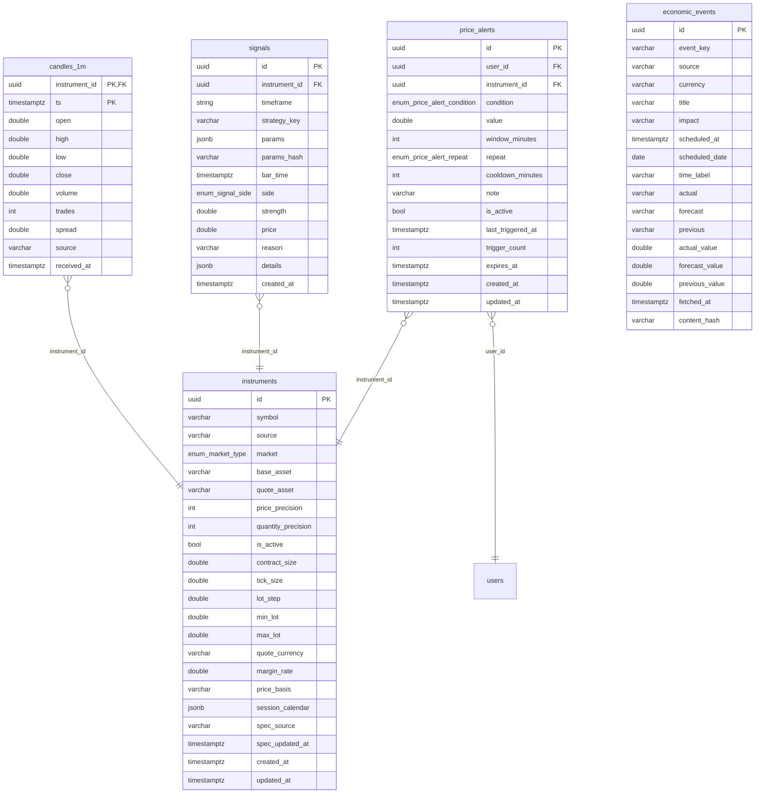
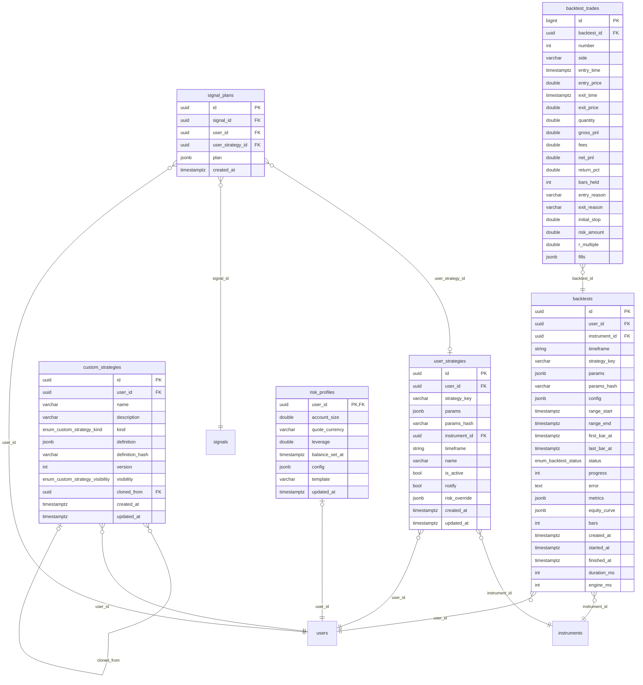
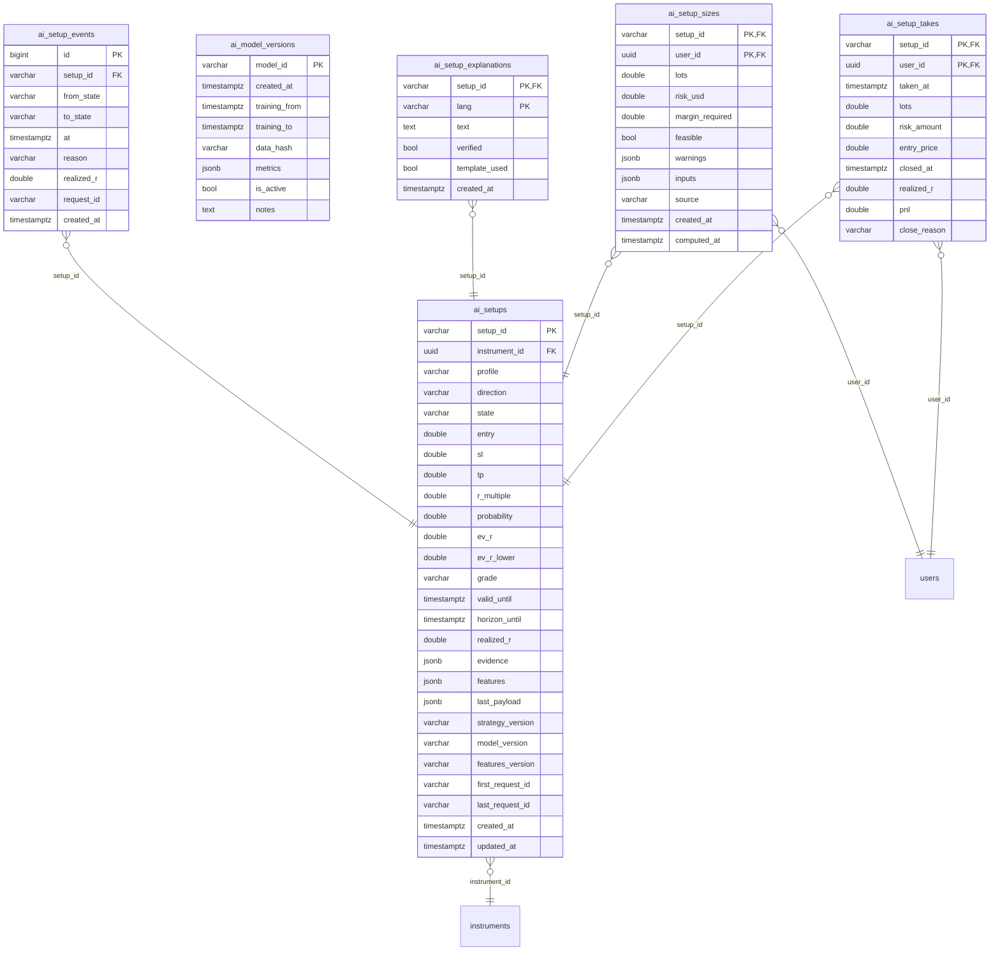
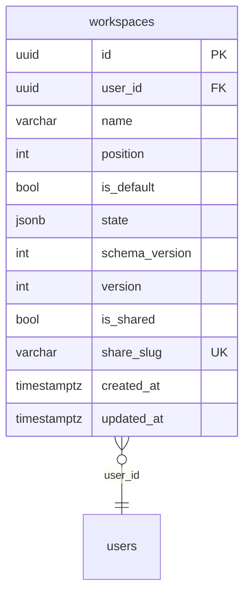
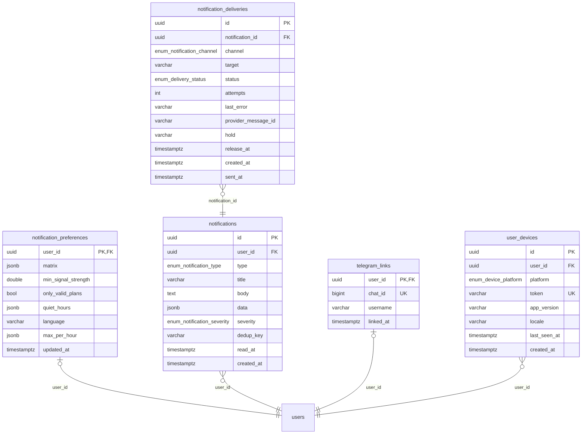
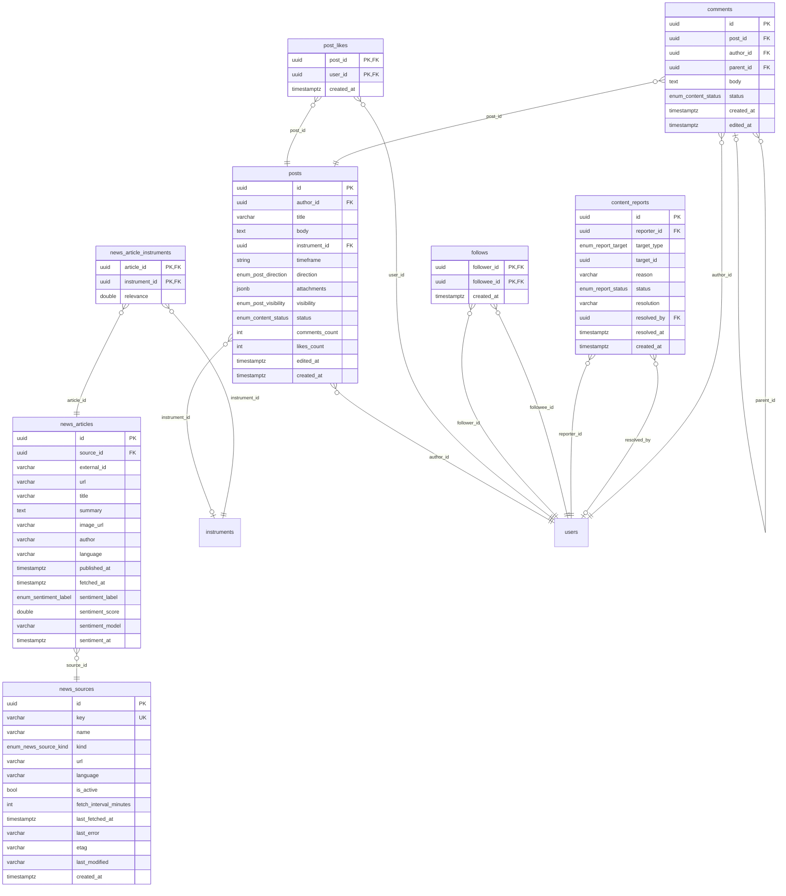
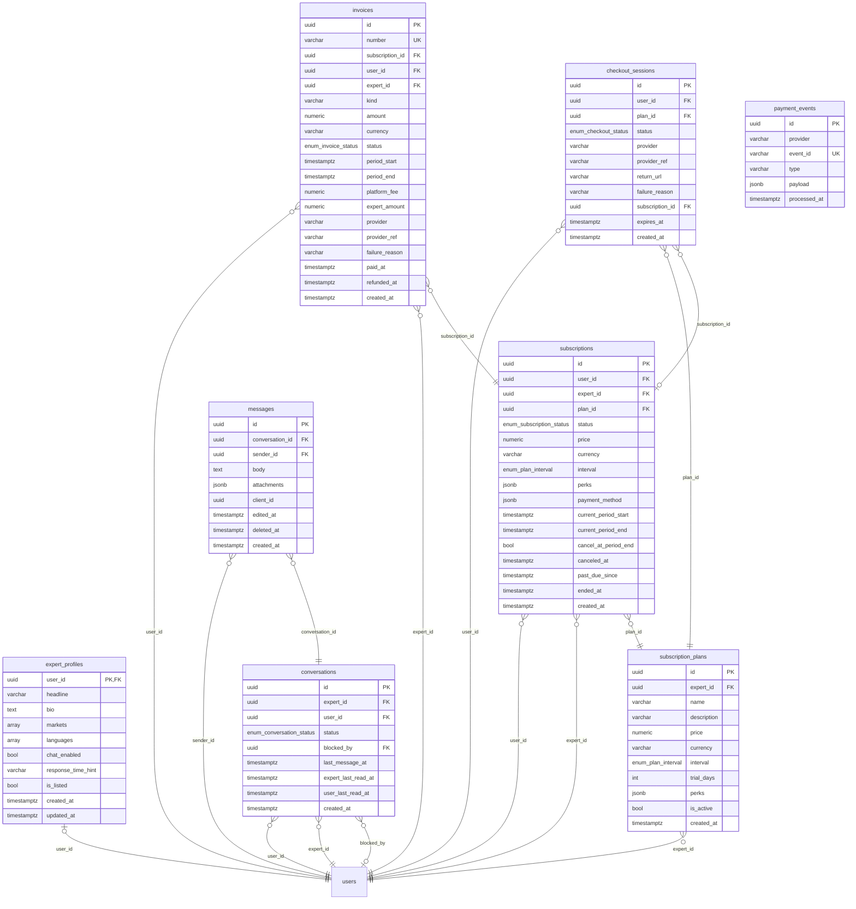

# Database (ERD)

<!-- Generated by backend/scripts/erd.py from the SQLAlchemy models; do not edit. -->

43 tables in 8 domains (PostgreSQL 16 + TimescaleDB 2.17). Column-level details: [tables.md](tables.md). Images: [img/](img/).

Relations: `}o--||` many-to-one, `}o--o|` many-to-optional-one (nullable FK), `|o--||` one-to-one. Tables of another domain appear without columns.

## Overview (tables and relations)

```mermaid
flowchart LR
    subgraph domain_auth["Auth, sessions and API keys"]
        direction TB
        users[users]
        refresh_tokens[refresh_tokens]
        api_keys[api_keys]
        login_fingerprints[login_fingerprints]
    end
    subgraph domain_market["Market data, signals and price alerts"]
        direction TB
        instruments[instruments]
        candles_1m[candles_1m]
        signals[signals]
        price_alerts[price_alerts]
        economic_events[economic_events]
    end
    subgraph domain_strategies["Strategies, backtests and risk"]
        direction TB
        user_strategies[user_strategies]
        custom_strategies[custom_strategies]
        backtests[backtests]
        backtest_trades[backtest_trades]
        risk_profiles[risk_profiles]
        signal_plans[signal_plans]
    end
    subgraph domain_ai["AI engine (ai-service setups and models)"]
        direction TB
        ai_setups[ai_setups]
        ai_setup_events[ai_setup_events]
        ai_model_versions[ai_model_versions]
        ai_setup_sizes[ai_setup_sizes]
        ai_setup_takes[ai_setup_takes]
        ai_setup_explanations[ai_setup_explanations]
    end
    subgraph domain_workspaces["Workspaces"]
        direction TB
        workspaces[workspaces]
    end
    subgraph domain_notifications["Notifications"]
        direction TB
        notifications[notifications]
        notification_deliveries[notification_deliveries]
        notification_preferences[notification_preferences]
        telegram_links[telegram_links]
        user_devices[user_devices]
    end
    subgraph domain_social["News and social"]
        direction TB
        news_sources[news_sources]
        news_articles[news_articles]
        news_article_instruments[news_article_instruments]
        posts[posts]
        comments[comments]
        post_likes[post_likes]
        follows[follows]
        content_reports[content_reports]
    end
    subgraph domain_subscriptions["Subscriptions and chat"]
        direction TB
        expert_profiles[expert_profiles]
        subscription_plans[subscription_plans]
        subscriptions[subscriptions]
        invoices[invoices]
        checkout_sessions[checkout_sessions]
        payment_events[payment_events]
        conversations[conversations]
        messages[messages]
    end
    ai_setup_events --> ai_setups
    ai_setup_explanations --> ai_setups
    ai_setup_sizes --> ai_setups
    ai_setup_sizes -.-> users
    ai_setup_takes --> ai_setups
    ai_setup_takes -.-> users
    ai_setups --> instruments
    api_keys -.-> users
    backtest_trades --> backtests
    backtests --> instruments
    backtests -.-> users
    candles_1m --> instruments
    checkout_sessions --> subscription_plans
    checkout_sessions --> subscriptions
    checkout_sessions -.-> users
    comments --> posts
    comments -.-> users
    content_reports -.-> users
    conversations -.-> users
    custom_strategies -.-> users
    expert_profiles -.-> users
    follows -.-> users
    invoices --> subscriptions
    invoices -.-> users
    login_fingerprints -.-> users
    messages --> conversations
    messages -.-> users
    news_article_instruments --> instruments
    news_article_instruments --> news_articles
    news_articles --> news_sources
    notification_deliveries --> notifications
    notification_preferences -.-> users
    notifications -.-> users
    post_likes --> posts
    post_likes -.-> users
    posts --> instruments
    posts -.-> users
    price_alerts --> instruments
    price_alerts -.-> users
    refresh_tokens -.-> users
    risk_profiles -.-> users
    signal_plans --> signals
    signal_plans --> user_strategies
    signal_plans -.-> users
    signals --> instruments
    subscription_plans -.-> users
    subscriptions --> subscription_plans
    subscriptions -.-> users
    telegram_links -.-> users
    user_devices -.-> users
    user_strategies --> instruments
    user_strategies -.-> users
    workspaces -.-> users

```

Boxes are the domains below; solid arrows point from a table to the table it references, dotted arrows to `users`. Foreign keys to `users`: `ai_setup_sizes` (user_id), `ai_setup_takes` (user_id), `api_keys` (user_id), `backtests` (user_id), `checkout_sessions` (user_id), `comments` (author_id), `content_reports` (reporter_id), `content_reports` (resolved_by), `conversations` (blocked_by), `conversations` (expert_id), `conversations` (user_id), `custom_strategies` (user_id), `expert_profiles` (user_id), `follows` (followee_id), `follows` (follower_id), `invoices` (expert_id), `invoices` (user_id), `login_fingerprints` (user_id), `messages` (sender_id), `notification_preferences` (user_id), `notifications` (user_id), `post_likes` (user_id), `posts` (author_id), `price_alerts` (user_id), `refresh_tokens` (user_id), `risk_profiles` (user_id), `signal_plans` (user_id), `subscription_plans` (expert_id), `subscriptions` (expert_id), `subscriptions` (user_id), `telegram_links` (user_id), `user_devices` (user_id), `user_strategies` (user_id), `workspaces` (user_id).

## Auth, sessions and API keys

## Market data, signals and price alerts

## Strategies, backtests and risk

## AI engine (ai-service setups and models)

## Workspaces

## Notifications

## News and social

## Subscriptions and chat

## TimescaleDB objects

These are not plain tables, so the diagrams above show only `candles_1m` itself:

- **`candles_1m` is a hypertable** partitioned by `ts` in 7-day chunks (`create_hypertable(..., by_range('ts', INTERVAL '7 days'))`, without Timescale's default `ts` index: the primary key `(instrument_id, ts)` serves every query).
- **Compression**: chunks older than 30 days are compressed (`compress_segmentby = 'instrument_id'`, `compress_orderby = 'ts DESC'`).
- **No retention policy**: candles are kept (only news and notifications have retention, done by Celery tasks).
- **Continuous aggregates** (real-time: `materialized_only = false`, so the newest bucket is computed from the raw rows on read). Each has an index on `(instrument_id, ts DESC)` and a refresh policy:

| View | From | Bucket | Refresh start offset | End offset | Every |
|---|---|---|---|---|---|
| `candles_5m` | `candles_1m` | 5 minutes | 2 hours | 5 minutes | 1 minute |
| `candles_15m` | `candles_5m` | 15 minutes | 6 hours | 15 minutes | 5 minutes |
| `candles_1h` | `candles_15m` | 1 hour | 1 day | 1 hour | 15 minutes |
| `candles_4h` | `candles_1h` | 4 hours | 3 days | 4 hours | 1 hour |
| `candles_1d` | `candles_1h` | 1 day | 7 days | 1 day | 1 hour |

Higher timeframes are read from these views (`Timeframe.relation`); late backfills older than the refresh window trigger an explicit refresh (`market_service.refresh_aggregates`).
