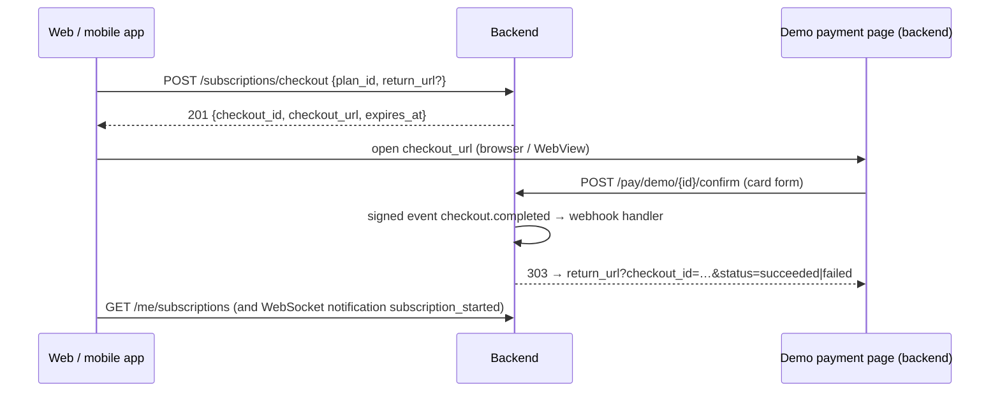
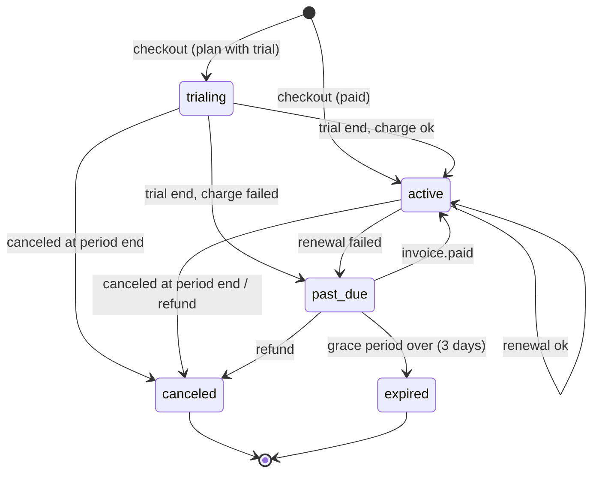

# Expert subscriptions (demo payments)

For the web (Elias) and mobile (Batoul) apps. Experts sell subscriptions; subscribers get
premium posts, chat with the expert and the expert's signals feed. **Payments are demo only:
no real money.** The flow still behaves like a real provider (hosted checkout page, signed
webhook, renewals, failed payments, cancellation, refunds, invoices), behind a provider
interface, so a real provider can be plugged in later (`backend/app/payments/provider.py`).

Base URL `/api/v1`, login token (`Authorization: Bearer …`) unless noted. Chat: [chat.md](chat.md).

## 1. Expert side

| Method | Path | |
|---|---|---|
| PUT | `/me/expert-profile` | experts only (403 otherwise): `{headline ≤ 120, bio (Markdown ≤ 5,000, same input rules as posts), markets: [crypto, forex, gold, commodities, stocks, indices], languages: [ar, en, fr, de, es, tr], chat_enabled, response_time_hint ≤ 60, is_listed}` |
| GET | `/me/expert-profile` | 404 until created |
| GET / POST | `/me/plans` | list (active and not) / create: `{name, description?, price ("29.00", ≤ 100,000), currency (USD \| EUR), interval (month \| year), trial_days (0–30), perks {premium_posts, chat, signals_feed}, is_active}`. **At most 3 active plans** (409) |
| PATCH | `/me/plans/{id}` | any field except `currency`/`interval` |
| DELETE | `/me/plans/{id}` | deactivates (plans are never deleted; subscriptions refer to them) |
| GET | `/me/earnings` | below |

**Price changes** never change a running period: a subscription keeps the price it was bought
at (copied onto it). At its **next renewal** it moves to the plan's current price and perks (a
deactivated plan keeps renewing at the old price and perks).

## 2. Checkout (sequence)



1. `POST /subscriptions/checkout {"plan_id": "…", "return_url": "http://localhost:5173/billing/done"}`
   → 201
   ```json
   {"checkout_id": "…", "checkout_url": "/api/v1/pay/demo/…", "checkout_path": "/api/v1/pay/demo/…",
    "status": "open", "expires_at": "…"}
   ```
   - `checkout_url` is absolute when the server sets `PUBLIC_BASE_URL`; otherwise prefix the
     path with your API origin (e.g. `http://187.127.76.76:8080`).
   - `return_url` must be on an allowed origin (`CORS_ORIGINS` or `PAYMENT_RETURN_URL`), else
     422. Without it, the browser lands on the API's own result page.
   - Errors: 404 plan unknown or inactive, 400 your own plan, 409 you already have a live
     subscription with this expert (one per expert).
2. Open the page (web: redirect or new tab; mobile: WebView, watch for the return URL). It is
   titled **"Demo payment — no real money"**, shows the plan and the amount due today (0.00
   during a trial), and accepts **test cards** only:

   | Card | Result |
   |---|---|
   | `4242 4242 4242 4242` | succeeds, renewals succeed |
   | `4000 0000 0000 0002` | declined at checkout |
   | `4000 0000 0000 9995` | succeeds now, **renewals fail** |

   Any future expiry (MM/YY) and any 3-digit CVC. Only the brand, the last 4 digits and the
   test behavior are kept, never the number. Unknown cards or bad fields re-show the form (422).
3. Submitting the form makes the demo "provider" send a signed event (`checkout.completed` or
   `checkout.failed`) to the payment webhook handler, then redirect (303) to
   `return_url?checkout_id=…&status=succeeded|failed`.
4. Poll or refresh `GET /me/subscriptions`; the notifications `subscription_started` (subscriber)
   and `new_subscriber` (expert) also arrive on the WebSocket.

A checkout expires after 30 minutes (`CHECKOUT_TTL_MINUTES`); the page then says "Checkout
expired". A completed or declined checkout cannot be paid again (409 page).

## 3. Webhook (how a real provider plugs in)

`POST /payments/webhook/{provider}` (no login). The demo signs every event with HMAC-SHA256:
header `Demo-Signature: t=<unix>,v1=<hex(hmac(secret, "<t>." + body))>`, 5-minute tolerance
(401 otherwise). The secret is `PAYMENT_DEMO_WEBHOOK_SECRET`, or generated on first use and
shared through Redis. Events are stored in `payment_events` (unique `event_id`): a repeated
event answers `{"status": "duplicate"}` and changes nothing.

| Event | Effect |
|---|---|
| `checkout.completed` | subscription `trialing` (plan has a trial) or `active`, plus a paid invoice (0.00 `trial` or the price, `initial`) |
| `checkout.failed` | checkout `canceled` with the reason |
| `invoice.paid` | a failed/open invoice paid later: subscription `active`, new period |
| `invoice.payment_failed` | invoice `failed`, subscription `past_due` |

A Stripe provider would map Checkout Sessions to `create_checkout`,
`checkout.session.completed` / `invoice.paid` / `invoice.payment_failed` to these events, the
Refunds API to `refund`, and `stripe.Webhook.construct_event` to `parse_event` (same `t=…,v1=…`
scheme). Not implemented: no Stripe code or keys exist.

## 4. Statuses and transitions



| Status | Access | Meaning |
|---|---|---|
| `trialing` | yes | free trial, first charge at `current_period_end` |
| `active` | yes | paid until `current_period_end` (`cancel_at_period_end` may be set) |
| `past_due` | yes, **until `grace_ends_at`** (3 days) | a renewal failed (`SUBSCRIPTION_GRACE_DAYS`) |
| `canceled` | no | ended at period end after a cancel, or by a refund |
| `expired` | no | payment failed and the grace period ended |

**Renewals** run every hour (beat `subscriptions.renew`, minute 7): for each live subscription
whose period ended, an invoice (`renewal`) is charged through the provider. Success → new period
(one calendar month or year), `subscription_renewed`. Failure → `past_due`,
`subscription_payment_failed` (with the grace end). A trial end is the same as a renewal. A
subscription with `cancel_at_period_end` ends as `canceled` instead of renewing.

**Subscriber actions:**

| Method | Path | |
|---|---|---|
| GET | `/me/subscriptions` | newest first, with `status`, period, `next_charge_at`, `grace_ends_at`, `payment_method {brand, last4, behavior}`, `perks`, `invoices` |
| POST | `/me/subscriptions/{id}/cancel` | at period end (access continues); 409 if ended |
| POST | `/me/subscriptions/{id}/resume` | undo the cancel before the period ends |

Invoices: `{id, number "INV-2026-000123", kind (trial | initial | renewal), amount, currency,
status (open | paid | failed | refunded | void), period_start, period_end, failure_reason,
paid_at, refunded_at}`.

## 5. Entitlements

One rule (`app/payments/entitlements.py`), used everywhere: a subscription entitles while
`trialing`, `active`, or `past_due` within the grace period, to the **perks copied onto it**
(`premium_posts`, `chat`, `signals_feed`). Experts are entitled to their own content, admins to
everything. `GET /experts/{id}` returns the caller's `entitlements`.

| Perk | What it unlocks |
|---|---|
| `premium_posts` | posts with visibility `subscribers` ([news-posts.md](news-posts.md)): others see a teaser (`locked: true`, first 200 characters, no attachments) and the comments are hidden and closed (403 on posting) |
| `chat` | opening a conversation and writing to the expert ([chat.md](chat.md)); after the end the conversation is read-only for the subscriber |
| `signals_feed` | `GET /experts/{id}/signals` (403 otherwise) |

`new_post` notifications of a `subscribers` post go to the expert's entitled subscribers only.

## 6. Directory and the signals feed

- `GET /experts?market=forex&language=ar&q=gold&limit&offset` — listed experts, most subscribers
  first: `{id, display_name, headline, markets, languages, chat_enabled, response_time_hint,
  followers_count, subscribers_count, rating (null for now), cheapest_plan, is_subscribed}`.
  No e-mails, no ids of other users.
- `GET /experts/{id}` — the card plus `bio`, `member_since`, active `plans`, your `entitlements`
  and 5 recent posts (premium ones as teasers unless entitled). Unlisted experts are still
  reachable by id.
- `GET /experts/{id}/signals` — signals of the expert's **public custom strategies** that the
  expert has activated, newest first, each with the expert's trade plan (Y13) when one was
  computed: `{id, instrument {id, symbol}, timeframe, strategy_key, strategy_name, side,
  strength, price, reason, bar_time, plan}`.

## 7. Earnings (`GET /me/earnings`, experts)

```json
{
  "currency": "USD",
  "platform_fee_pct": 20.0,
  "active_subscribers": 3,
  "by_status": {"active": 2, "trialing": 1},
  "mrr": "40.00",
  "churn_30d_pct": 25.0,
  "ended_30d": 1,
  "months": [{"month": "2026-10", "gross": "180.00", "platform_fee": "36.00", "net": "144.00",
              "refunded": "0.00", "invoices": 4}],
  "recent_invoices": [{"number": "INV-2026-000041", "kind": "initial", "amount": "30.00",
                       "currency": "USD", "status": "paid", "platform_fee": "6.00",
                       "net": "24.00", "subscriber": "Omar Trader", "plan": "Monthly",
                       "paid_at": "…", "created_at": "…"}]
}
```

- **MRR**: monthly price of paying subscriptions (`active`, `past_due` in grace), yearly prices
  / 12; trials excluded.
- **Platform fee**: `PLATFORM_FEE_PCT` (20 %) of every paid invoice, recorded on the invoice when
  it is paid (`platform_fee`, `expert_amount`).
- **Months**: last 12 months by payment date. `gross`, fee and `net` count paid invoices;
  `refunded` the refunded ones.
- **Churn (30 days)**: subscriptions that ended in the last 30 days / (entitled now + those).
- Subscribers appear by display name only.

## 8. Admin tools

| Method | Path | |
|---|---|---|
| GET | `/admin/subscriptions?status&expert_id&user_id` | `Page` |
| GET | `/admin/payments/stats` | invoices per status (count, amount), platform fees, subscriptions per status, MRR across experts |
| POST | `/admin/invoices/{id}/refund` | a paid invoice → `refunded`; its subscription ends **now** (`canceled`) |
| POST | `/admin/subscriptions/{id}/fast-forward` | **demo only**: `{"to": "period_end"}` ends the current period now and processes it (renewal / failure / cancel); `{"to": "grace_end"}` ends the grace period of a `past_due` one. 403 when `ENVIRONMENT=production` unless `PAYMENT_DEMO_TOOLS=true` |

## 9. Notifications ([notifications.md](notifications.md))

| Type | To | Default channels |
|---|---|---|
| `subscription_started` | subscriber | in-app, email, push |
| `subscription_renewed` | subscriber | in-app, email |
| `subscription_payment_failed` (warning) | subscriber | in-app, Telegram, email, push |
| `subscription_canceled` | subscriber (canceled at period end, expired, refunded) | in-app, email, push |
| `new_subscriber` | expert | in-app, email, push |

Push `data`: `{"screen": "subscription", "subscription_id"}` (`"earnings"` for
`new_subscriber`).

## 10. Settings

| Variable | Default | |
|---|---|---|
| `PAYMENT_PROVIDER` | `demo` | the only provider |
| `PAYMENT_DEMO_WEBHOOK_SECRET` | empty | empty: generated once, kept in Redis |
| `PAYMENT_DEMO_TOOLS` | `false` | the fast-forward tool in production |
| `PAYMENT_RETURN_URL` | empty | default return page of the demo checkout |
| `PUBLIC_BASE_URL` | empty | makes `checkout_url` absolute |
| `PLATFORM_FEE_PCT` | 20 | |
| `SUBSCRIPTION_GRACE_DAYS` | 3 | |
| `CHECKOUT_TTL_MINUTES` | 30 | |
